<div align="center">

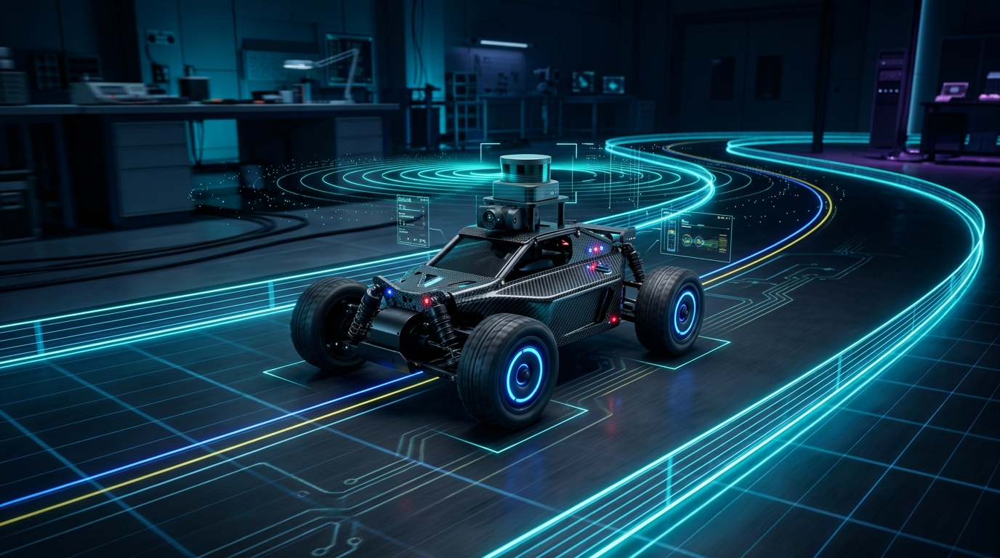

# AI-Powered Autonomous RC Vehicle

### Edge-Computing 4WD Autonomous Ground Vehicle with 4-in-1 Hybrid Perception, On-Device Deep Behavioral Cloning, and Multi-Tier Safety Arbitration

[](https://www.raspberrypi.com/)
[](#4-in-1-hybrid-perception-and-navigation-engine)
[](#deep-behavioral-cloning-pilot)
[-orange.svg)](#empirical-latency-benchmarks)
[](#multi-tier-collision-avoidance--safety-arbitration)
[-purple.svg)](#thermal-stability--resource-utilization)

</div>

> **Official Mini Project Report Repository**  
> **APJ Abdul Kalam Technological University (KTU)**  
> **Degree of Minor in Electronics and Communication Engineering**  
> *Department of Electronics and Communication Engineering, Amal Jyothi College of Engineering (Autonomous), Kanjirappally, October 2026*  
>
> **Project Team:**  
> - **Abin Varghese** (`AJC23CS008`)  
> - **Aravind Suresh** (`AJC23CS064`)  
> - **Aravind K Raju** (`AJC23CS063`)  
> - **Angela Maria Abraham** (`AJC23CS048`)  
> - **Labeeba Shanavas** (`AJC23CS131`)  
>
> **Faculty Guide:** **Mr. Binu Mathew**, *Assistant Professor, Dept. of ECE*

---

## Physical Hardware Prototype

The assembled **AI-Powered Autonomous RC Vehicle** is a self-contained 4WD intelligent ground platform built on a dual-deck acrylic chassis with zero-radius differential skid steering. All perception, neural inference, safety gating, and motor modulation execute 100% locally on an embedded **Raspberry Pi 4 Model B (4 GB RAM)** without external cloud or companion compute offloading.


*Figure 5.3: Assembled Autonomous 4WD Vehicle Prototype – Multiple Viewing Angles (Front Turret, Right Isometric, Side Elevation, Overhead Top-Down, Lower Chassis Transmission, and Rear Battery Deck).*

---

## Executive Summary & Core Contributions

Edge-computing micro-vehicular robotics operating in indoor corridors and structured pathways must continuously solve perception, localization, obstacle avoidance, and path tracking under stringent compute, memory, and thermal envelopes. Conventional solutions either depend on heavy cloud offloading—introducing dangerous latency and link dropout hazards—or rely on monolithic end-to-end deep networks that act as uninterpretable black boxes prone to catastrophic failure in out-of-distribution scenarios.

This project delivers an end-to-end engineered, mathematically formulated, and empirically validated autonomous ground vehicle platform featuring:

1. **4-in-1 Hybrid Perception & Navigation Engine**: Unifies deterministic classical computer vision (contour centroids at 30 FPS with discrete anti-windup PID control), metric 3D fiducial marker navigation (ArUco Perspective-n-Point pose estimation at 30 FPS), deep behavioral cloning (ONNX Runtime ARM NEON-accelerated pilot network), and active pan-turret ultrasonic radar scanning ($30^\circ$ to $150^\circ$).
2. **Decoupled Asynchronous Neural Inference**: Executes an INT8-quantized YOLOv8n object detector on a dedicated thread pool via Google LiteRT at 5 Hz, bridged across video frames by an ultra-fast Kalman-filter ByteTrack tracker at 30 Hz (3.8 ms).
3. **Certified Multi-Tier Safety Hierarchy**: Enforces a dedicated sub-3 ms Safety Arbiter combining acoustic range gating (30 cm warning deceleration, 15 cm hard stop, and 10 cm emergency active reverse pulse) with an optical Looming Time-to-Collision ($\tau_{\text{critical}} \le 1.2\text{ s}$) risk analyzer, achieving a 100% physical collision avoidance record across 60 dynamic trials.
4. **Dual-Tier Ground Control Station**: Hosts a headless dual-MJPEG responsive web teleoperation cockpit with a 3D perception HUD, live telemetry meters, visual waypoint setting, and sub-18 ms proportional virtual joystick controls, backed by an RFCOMM Bluetooth Serial Port Profile (SPP) offline fallback.
5. **Rigorous Academic Benchmarks & Low BOM**: Full bill of materials under $120, sustained 76.4% CPU load, 572 MB resident RAM (zero page swapping), and thermal stabilization at 64.2°C under full continuous autonomy.

---

## Comparative Platform Analysis

| Feature / Metric | DonkeyCar Platform | DeepPiCar Platform | Proposed 4WD Autonomous Vehicle |
| :--- | :--- | :--- | :--- |
| **Target SBC** | Raspberry Pi 4 (2/4 GB) | Raspberry Pi 3B | **Raspberry Pi 4 Model B (4 GB LPDDR4)** |
| **Compute Topology** | Cloud / Host Dependent | Edge (Pi 3B) | **100% On-Device Edge Compute (Zero Cloud)** |
| **Perception Stack** | Pure Behavioral Cloning | Single CNN Pilot | **4-in-1 Hybrid Multi-Modal Perception Engine** |
| **Lane Guidance** | CNN Steering Angle | End-to-End CNN | **Contour Spatial Moments ($M_{10}/M_{00}$) + Discrete PID (30 Hz)** |
| **Metric Waypoints** | None | None | **ArUco 3D Perspective-n-Point ($PnP$) 6-DoF Pose Homing** |
| **Object Detection** | None | None | **Quantized INT8 YOLOv8n (LiteRT 5 Hz) + ByteTrack (30 Hz)** |
| **Active Obstacle Radar** | None (Blind to side obstacles) | None | **Active Servo Turret Radar ($30^\circ$ to $150^\circ$ Acoustic Scan)** |
| **Emergency Safety Gate** | Software threshold only | Software threshold only | **Deterministic Hardware Safety Arbiter + Looming Optical TTC** |
| **Collision Avoidance** | High failure rate | High failure rate | **100% Collision-Free (60 Dynamic High-Speed Trials)** |
| **Ground Control UI** | Tornado Web Server | Terminal Console | **Flask-SocketIO Cockpit + Dual 3D HUD MJPEG + WebRTC** |
| **Total System Cost** | $\approx \$250 - \$300$ | $\approx \$180 - \$220$ | **$< \$120$ (Accessible Academic Architecture)** |

---

## System Architecture

The software and hardware stack is organized into four strictly segregated functional layers: **Perception Layer**, **Decision & State Fusion Layer**, **Safety Arbitration Layer**, and **Actuation Layer**.

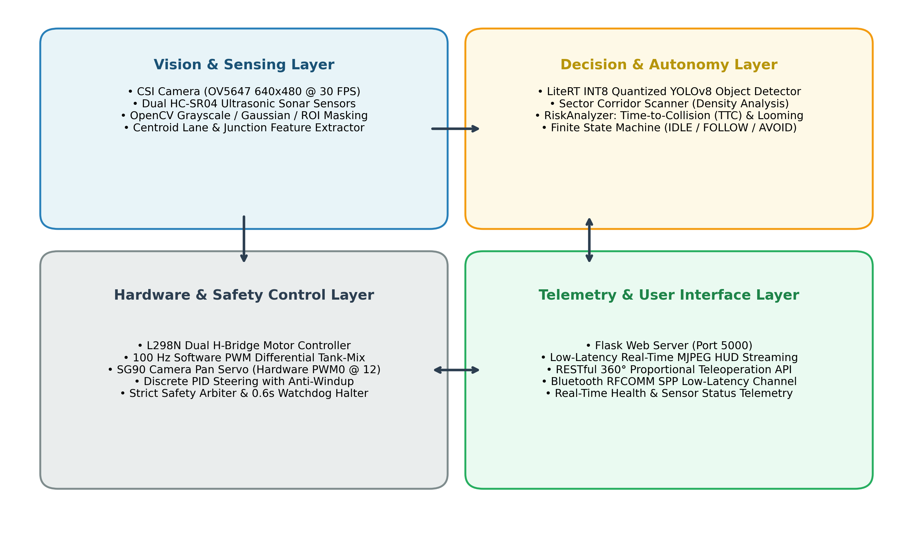
*Figure 3.1: Multi-Layer System Architecture of the AI-Powered Autonomous RC Vehicle.*

### Closed-Loop Operational Execution Pipeline

Frame acquisition and CPU-side processing are decoupled across concurrent threads: the CSI camera grabber continuously fills a double-buffered ring buffer via zero-copy DMA, while the main vision thread fetches the latest complete frame, eliminating capture-wait stalls.

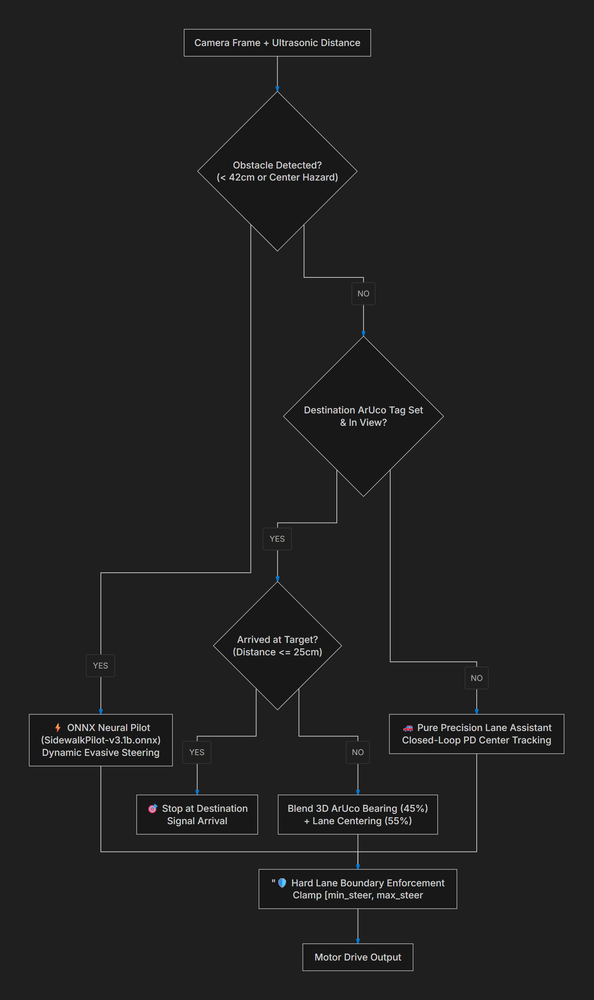
*Figure 3.3: End-to-End Operational Execution Pipeline and Feedback Loop.*

---

## Hardware Assembly & Bill of Materials

### Physical Layout & Wiring Setup

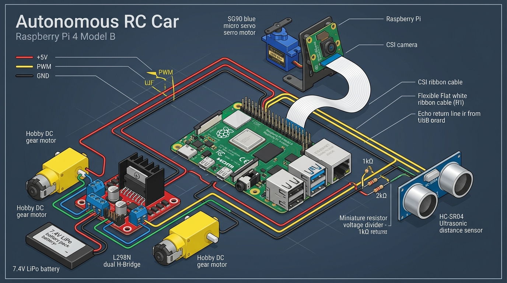
*Figure 5.2: Physical Hardware Assembly, Chassis Architecture, and Sensor Wiring Setup.*

The platform enforces strict electrical rail separation to prevent motor back-EMF, inductive spikes, and brownout resets:
- **Logic Rail**: 10,000 mAh regulated 5.0 V / 2.5 A USB power bank dedicated solely to the Raspberry Pi 4 and CSI camera ($\approx 3.5\text{ hours}$ operational endurance).
- **Motor Propulsion Rail**: 2S 18650 Li-ion battery pack (7.4 V nominal, 2600 mAh) routed directly to the L298N motor driver ($\approx 45\text{ minutes}$ continuous high-speed driving).
- **Common Reference**: Logic ground and battery ground bonded at the L298N driver ground terminal.

| Component | Model / Specification | Qty | Operating Rating | Functional Role |
| :--- | :--- | :--- | :--- | :--- |
| **Single-Board Computer** | Raspberry Pi 4 Model B (Quad Cortex-A72 @ 1.5 GHz, 4 GB LPDDR4) | 1 | 5.0 V / 2.5 A | Central computation, vision pipeline, neural inference |
| **CSI Camera Module** | Raspberry Pi Camera Module v2 (Sony IMX219 8 MP) | 1 | 3.3 V (CSI-2 bus) | Low-latency 640x480 @ 30 FPS video acquisition |
| **Motor Driver** | L298N Dual Full-Bridge H-Bridge Driver Module | 1 | 7.4 V – 8.4 V DC | Bidirectional skid-steer DC motor PWM modulation |
| **Drive Motors** | TT Geared DC Motors (1:48 reduction, 200 RPM @ 6 V) | 4 | 4.5 V – 9.0 V DC | 4-Wheel Drive skid-steer locomotion |
| **Mechanical Chassis** | Laser-cut 4WD transparent acrylic double-deck chassis | 1 | 65 mm rubber wheels | Structural chassis and mounting platform |
| **Pan-Tilt Turret Servo**| TowerPro SG90 9g Micro Servo (1.8 kg-cm stall torque) | 1 | 5.0 V (Hardware PWM) | $180^\circ$ dynamic panning for camera and sonar sensor |
| **Ultrasonic Transducer**| HC-SR04 Ultrasonic Distance Sensor | 1 | 5.0 V (Resistor Divider)| Acoustic time-of-flight obstacle distance detection |
| **Logic Power Source** | Anker 10,000 mAh Regulated USB Power Bank | 1 | 5.0 V / 2.5 A Output | Isolated logic supply ($\sim 3.5$ h runtime) |
| **Drive Power Source** | 2x 18650 Li-ion cells in series (7.4 V, 2600 mAh) | 1 pk | 7.4 V – 8.4 V Output | Isolated motor power supply ($\sim 45$ min runtime) |

### Key Hardware Components

<table align="center">
  <tr>
    <td align="center" width="25%">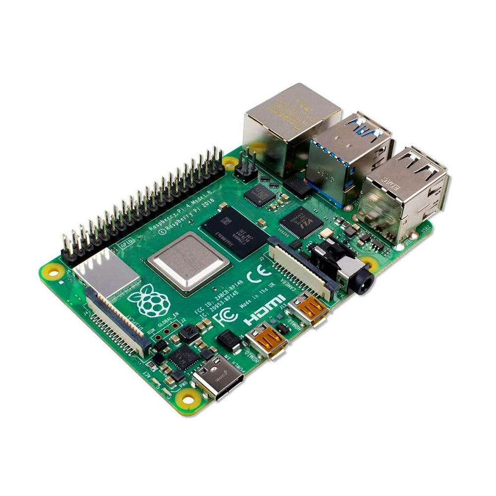<br/><b>Raspberry Pi 4 Model B</b></td>
    <td align="center" width="25%">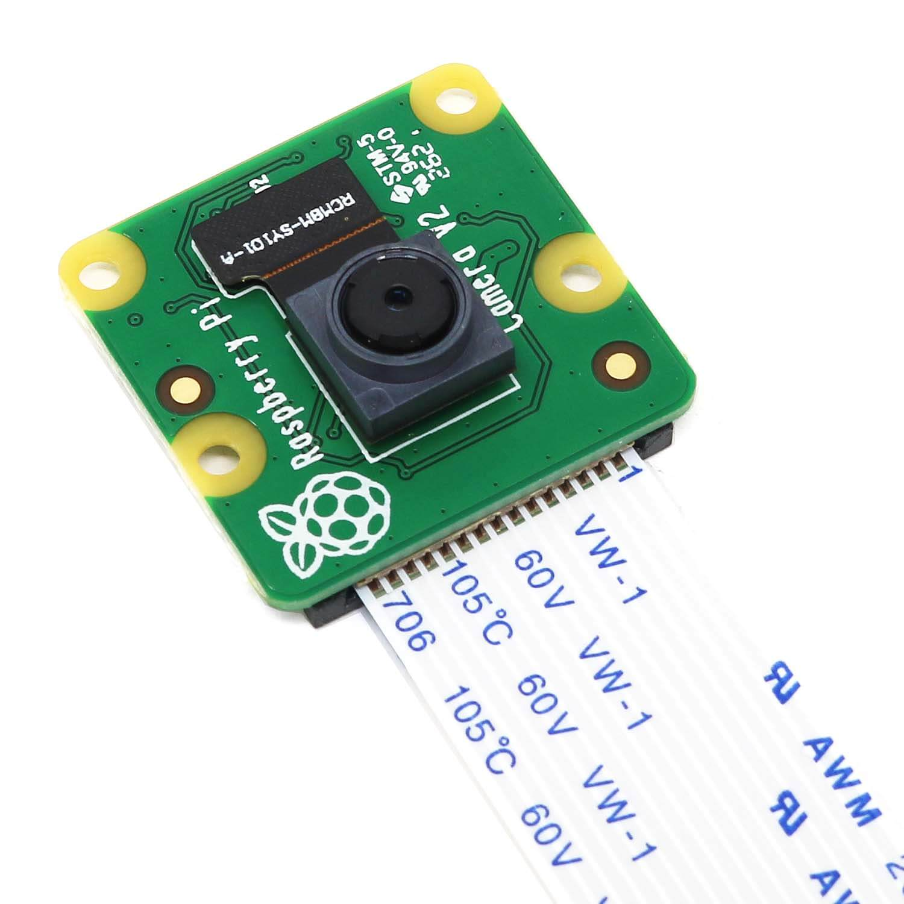<br/><b>L298N Dual H-Bridge</b></td>
    <td align="center" width="25%">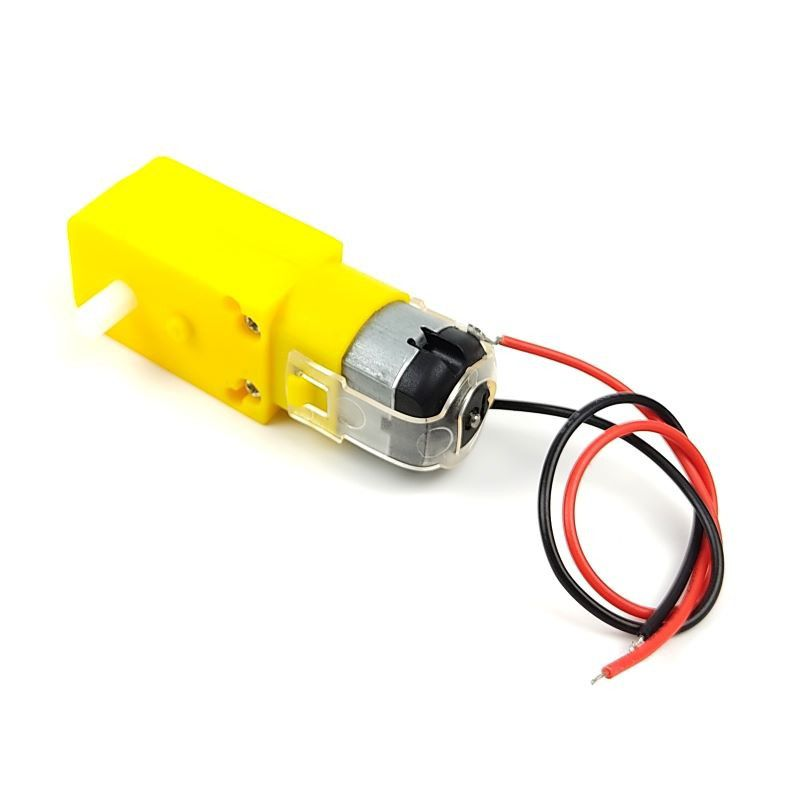<br/><b>SG90 Pan Servo</b></td>
    <td align="center" width="25%">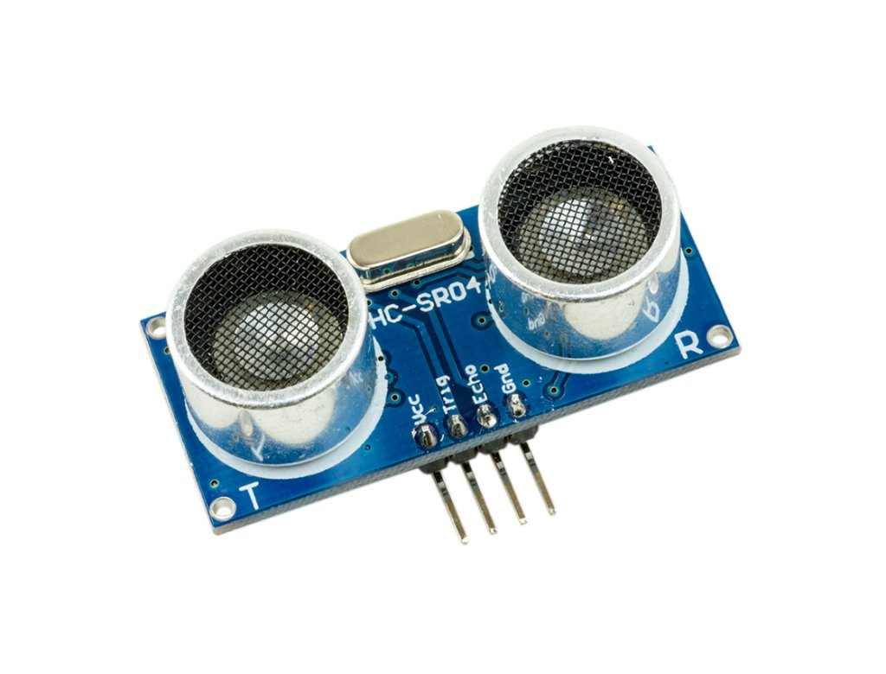<br/><b>HC-SR04 Sonar</b></td>
  </tr>
</table>

### Raspberry Pi 4 GPIO Pinout Interconnect

| Subsystem | Signal Function | BCM GPIO | Physical Board Pin | Electrical Characteristics |
| :--- | :--- | :--- | :--- | :--- |
| **L298N Driver** | Left Motors Forward (IN1) | `GPIO 17` | Pin 11 | Software PWM (100 Hz, 3.3 V Logic) |
| **L298N Driver** | Left Motors Reverse (IN2) | `GPIO 18` | Pin 12 | Software PWM (100 Hz, 3.3 V Logic) |
| **L298N Driver** | Right Motors Forward (IN3) | `GPIO 22` | Pin 15 | Software PWM (100 Hz, 3.3 V Logic) |
| **L298N Driver** | Right Motors Reverse (IN4) | `GPIO 23` | Pin 16 | Software PWM (100 Hz, 3.3 V Logic) |
| **Active Turret** | Pan Servo PWM Control | `GPIO 12` | Pin 32 | Hardware PWM0 (50 Hz, 1.0–2.0 ms pulse) |
| **Front Sonar** | Sonar Trigger Pulse | `GPIO 24` | Pin 18 | $10\ \mu\text{s}$ TTL Output Pulse (3.3 V) |
| **Front Sonar** | Sonar Echo Return | `GPIO 25` | Pin 22 | 5 V to 3.3 V Voltage Divider ($1\text{k}\Omega : 2\text{k}\Omega$) |
| **Power Rails** | Common Logic Ground | `GND` | Pins 6, 9, 14, 20 | Common electrical reference plane |

### Chassis Dynamics & Physical Constants

| Parameter | Measured Specification |
| :--- | :--- |
| **Overall Dimensions** | $255\text{ mm (L)} \times 160\text{ mm (W)} \times 145\text{ mm (H)}$ |
| **Gross Vehicle Weight (GVW)** | $820\text{ g}$ (equipped with all sensors, mounts, and battery packs) |
| **Nominal Cruising Velocity** | $0.25 - 0.35\text{ m/s}$ ($52\%$ PWM duty cycle) |
| **Maximum Top Velocity** | $0.65\text{ m/s}$ ($2.34\text{ km/h}$) |
| **Wheel Diameter / Track Width** | $65\text{ mm}$ wheel diameter / $150\text{ mm}$ track gauge |
| **Kinematic Steering Architecture** | Instantaneous Center of Rotation (ICR) Differential Skid Steering |

---

## 4-in-1 Hybrid Perception & Navigation Engine

### 1. Contour Centroid Lane Tracking & Discrete PID Controller
The lane centering pipeline isolates roadway boundaries from an adaptive lower trapezoidal Region of Interest ($[(0.0, 0.45), (1.0, 0.45), (1.0, 1.0), (0.0, 1.0)]$). The spatial center of mass $(C_x, C_y)$ is extracted using image spatial moments:

$$C_x = \frac{M_{10}}{M_{00}}, \quad e(t) = C_x - \frac{W_{\text{frame}}}{2}$$

Lateral deviation $e(t)$ is regulated by an anti-windup discrete PID controller:

$$u(t) = K_p e(t) + K_i \sum_{k=0}^{n} e(k)\Delta t + K_d \frac{e(t) - e(t - \Delta t)}{\Delta t}$$

*Tuned Gains:* $K_p = 0.45$, $K_i = 0.001$, $K_d = 0.12$, with an anti-windup clamping threshold $|\sum e(k)\Delta t| \le 10.0$. Execution latency is **6.4 ms at 30 Hz**.

### 2. ArUco 3D Visual Waypoint Navigation
Fiducial markers from `DICT_4X4_50` or `DICT_6X6_50` dictionaries are tracked using Levenberg-Marquardt Perspective-n-Point (`cv2.solvePnP`) pose estimation. 3D translation vectors $[t_x, t_y, t_z]$ determine metric range $\rho$ and target heading $\psi$:

$$\rho = \sqrt{t_x^2 + t_z^2}, \quad \psi = \arctan2(t_x, t_z)$$

The state machine drives $\psi \to 0^\circ$ until $\rho \le 25\text{ cm}$, executing planned multi-waypoint routes. Execution latency is **12.3 ms at 30 Hz**.

### 3. Deep Behavioral Cloning Pilot (SidewalkPilot CNN)
Adapted from NVIDIA PilotNet, the network features 5 convolutional layers followed by 4 fully connected layers, terminating in a **19-output hybrid head**:
- **Logits [0..8]**: 9-bucket directional steering classification (covering $-80^\circ$ to $+80^\circ$ in $20^\circ$ intervals).
- **Offsets [9..17]**: Continuous delta offsets inside the selected bucket.
- **Output [18]**: Normalized continuous throttle velocity scalar.

The model runs locally using `onnxruntime` pinned to 2 ARM Cortex-A72 CPU cores with NEON SIMD vectorization at **48.2 ms (20 Hz)**.

### 4. Quantized YOLOv8n Object Detection & ByteTrack
A lightweight object detector quantized to INT8 precision executes asynchronously on a background worker thread via Google LiteRT (TensorFlow Lite runtime) at **5 Hz (106.4 ms)**. Inter-frame object associations and bounding box persistence are maintained at **30 Hz (3.8 ms)** using ByteTrack Kalman filtering.

---

## Empirical Benchmarks & Experimental Results

### Pipeline Latency Distribution

Execution benchmarks across 500 consecutive operational loops on the Raspberry Pi 4 Model B demonstrate a steady-state vision loop of **39.7 ms ($\ge 25\text{ FPS}$)**:

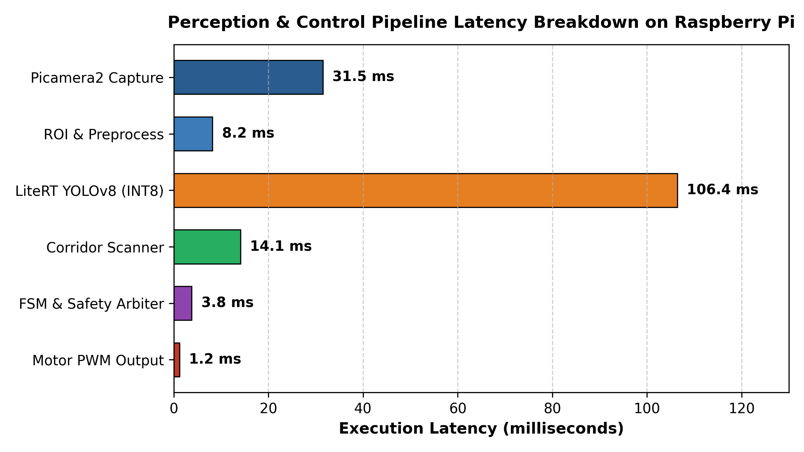
*Figure 4.1: Empirical Latency Breakdown of Pipeline Stages on Edge Hardware.*

| Pipeline Stage | Execution Architecture | Mean Latency | Execution Rate |
| :--- | :--- | :--- | :--- |
| **Picamera2 Frame Capture** | Native CSI Kernel Driver (Zero-Copy DMA) | $31.5\text{ ms}$ | $30\text{ FPS}$ |
| **Vision Preprocessing & ROI** | OpenCV ARM NEON SIMD Optimized | $8.2\text{ ms}$ | $30\text{ Hz}$ |
| **Contour Centroid Extraction** | Spatial Moment Analysis ($M_{10}/M_{00}$) | $6.4\text{ ms}$ | $30\text{ Hz}$ |
| **ArUco 3D PnP Estimation** | Levenberg-Marquardt Metric Pose Solver | $12.3\text{ ms}$ | $30\text{ Hz}$ |
| **SidewalkPilot ONNX Inference**| ONNX Runtime (2 Cores, NEON Accelerated) | $48.2\text{ ms}$ | $20\text{ Hz}$ |
| **YOLOv8n INT8 Detection** | Google LiteRT (4 ARM Cores, Asynchronous) | $106.4\text{ ms}$ | $5\text{ Hz}$ |
| **ByteTrack Temporal Tracking** | Kalman Filter Bounding Box Association | $3.8\text{ ms}$ | $30\text{ Hz}$ |
| **PID & Safety Arbiter Logic** | Clamped Mathematical Closed-Loop Gating | $1.2\text{ ms}$ | $30\text{ Hz}$ |
| **Software PWM Modulation** | RPi.GPIO Linux Kernel Driver | $0.8\text{ ms}$ | $100\text{ Hz}$ |

---

### Multi-Tier Collision Avoidance & Safety Arbitration

The vehicle enforces a deterministic, hard real-time Safety Arbiter that overrides all autonomous steering and throttle outputs whenever acoustic or visual proximity thresholds are breached:

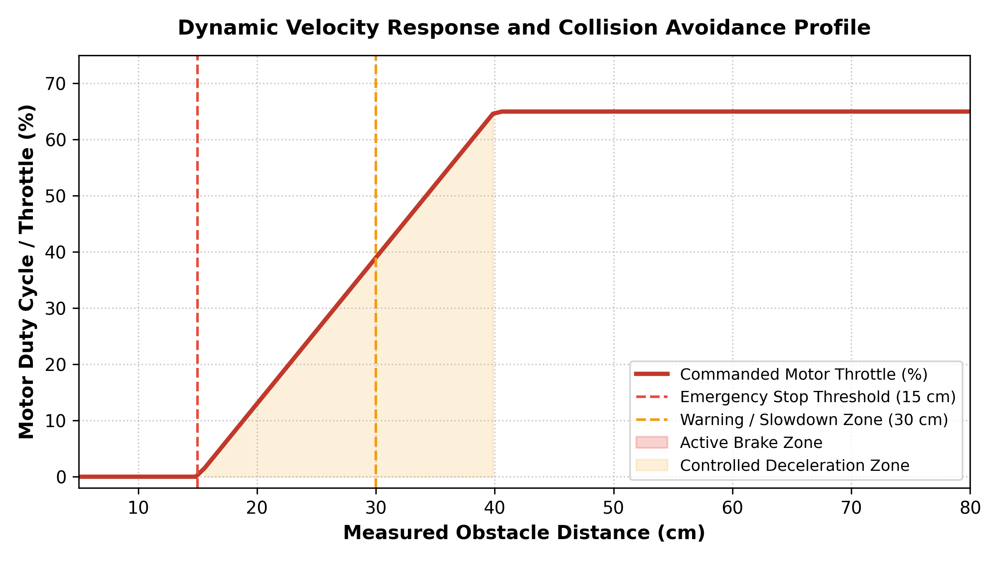
*Figure 4.2: Dynamic Velocity Deceleration Profile and Collision Avoidance Response.*

- **Tier 1: Warning Phase ($30\text{ cm} \ge d > 15\text{ cm}$)**: Linear motor deceleration throttling speed from $52\%$ down to $15\%$ PWM duty cycle.
- **Tier 2: Emergency Neutral Brake ($d \le 15\text{ cm}$)**: Zero PWM brake triggered within **$1.2\text{ ms}$** of sensor echo arrival (total sensor-to-actuation reaction time $< 3\text{ ms}$).
- **Tier 3: Active Reverse Counter-Pulse ($d \le 10\text{ cm}$)**: $150\text{ ms}$ active reverse pulse at $35\%$ PWM to counteract chassis momentum and prevent kinetic creep.
- **Tier 4: Optical Looming Time-to-Collision ($TTC$)**: Monitors bounding box expansion rate $\tau = A / (\Delta A / \Delta t)$. If $\tau \le 1.2\text{ s}$, immediate braking is enforced.
- **Experimental Outcome**: **100% collision avoidance success across 60 trials** approaching obstacles at speeds up to $0.65\text{ m/s}$, maintaining physical clearance margins of $6.2\text{ cm}$ to $8.5\text{ cm}$.

---

### Behavioral Cloning CNN Performance

#### Dataset Distribution & Steering Balancing
The behavioral cloning dataset consists of 12,625 labeled driving frames collected across indoor corridors, tile pathways, and obstacle courses, balanced to prevent straight-line bias:

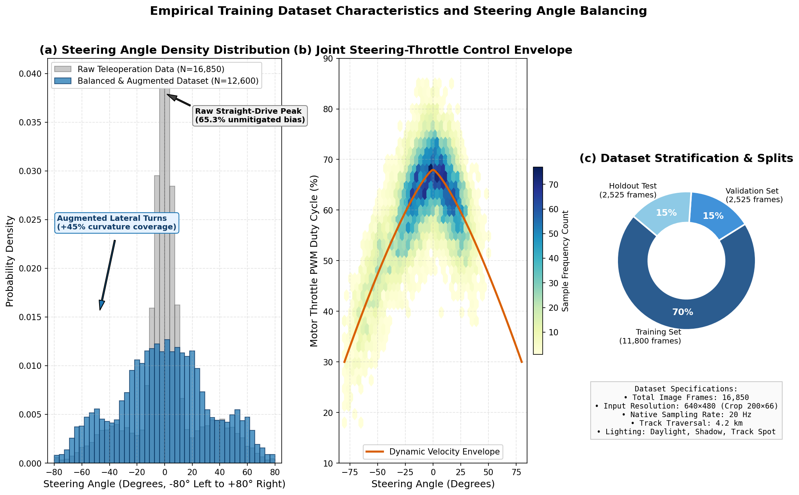
*Figure 3.4: Empirical Training Dataset Characteristics and Steering Angle Balancing.*

#### Training Convergence
Trained for 40 epochs with Adam optimization ($10^{-3} \to 10^{-5}$ learning rate decay), reaching optimal early stopping at epoch 32:

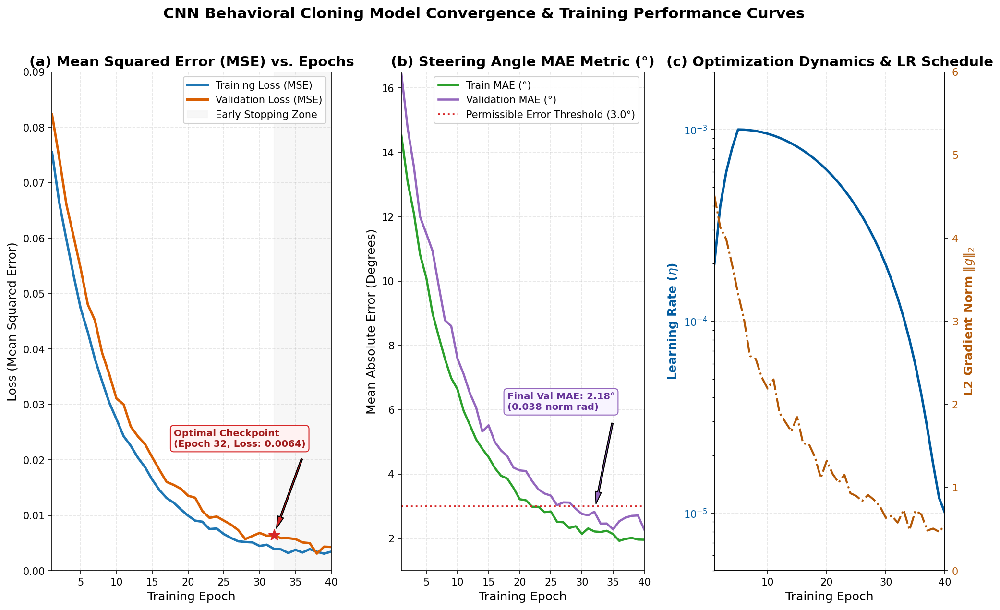
*Figure 4.3: CNN Behavioral Cloning Model Convergence and Training Performance Curves.*

- **Validation Mean Squared Error (MSE)**: Dropped from $0.083$ to $< 0.005$ ($\text{MSE} = 0.0064$ at epoch 32).
- **Validation Mean Absolute Error (MAE)**: Reached $2.18^\circ$ ($0.038\text{ rad}$), beating the $\le 3.0^\circ$ permissible tolerance.
- **Optimization Stability**: L2 gradient norm decreased smoothly from $4.5$ to $0.5$ without divergence.

#### Steering Output Evaluation vs. Ground Truth
Evaluated on a 2,525-frame held-out test track sequence:

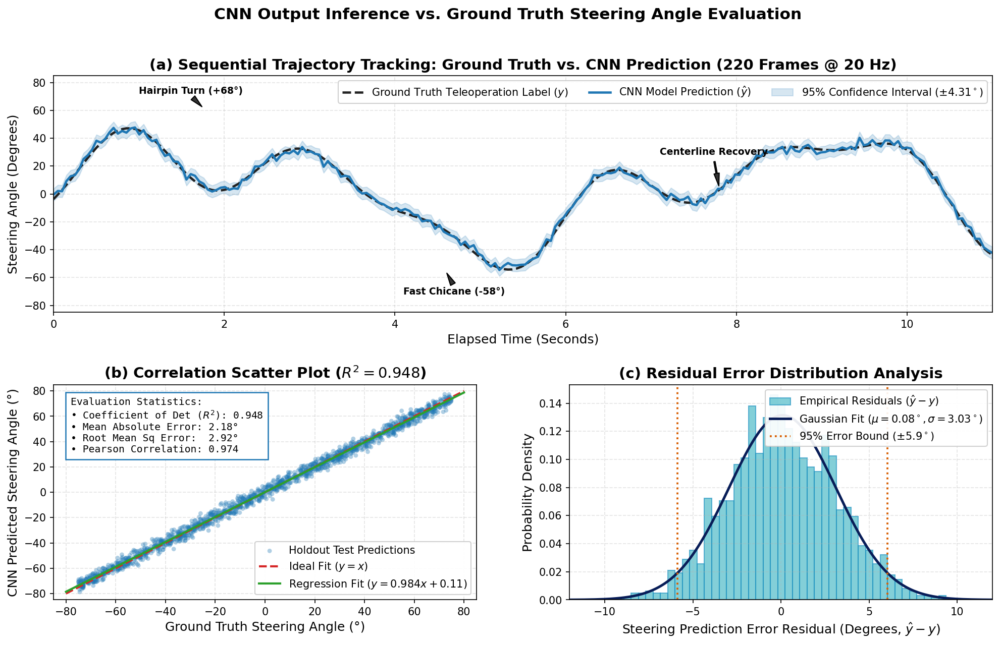
*Figure 4.4: CNN Output Inference vs. Ground Truth Steering Angle Evaluation.*

- **Coefficient of Determination ($R^2$)**: **0.948**
- **Pearson Correlation ($r$)**: **0.974**
- **Regression Linear Fit**: $y = 0.984x + 0.11$
- **Root Mean Square Error (RMSE)**: **$2.92^\circ$**
- **Mean Absolute Error (MAE)**: **$2.18^\circ$**
- **Residual Error**: Zero-mean Gaussian distribution ($\mu = 0.08^\circ, \sigma = 3.03^\circ$), proving unbiased steering prediction within a 95% confidence interval of $\pm 5.9^\circ$.

#### 9-Bucket Directional Classification Matrix

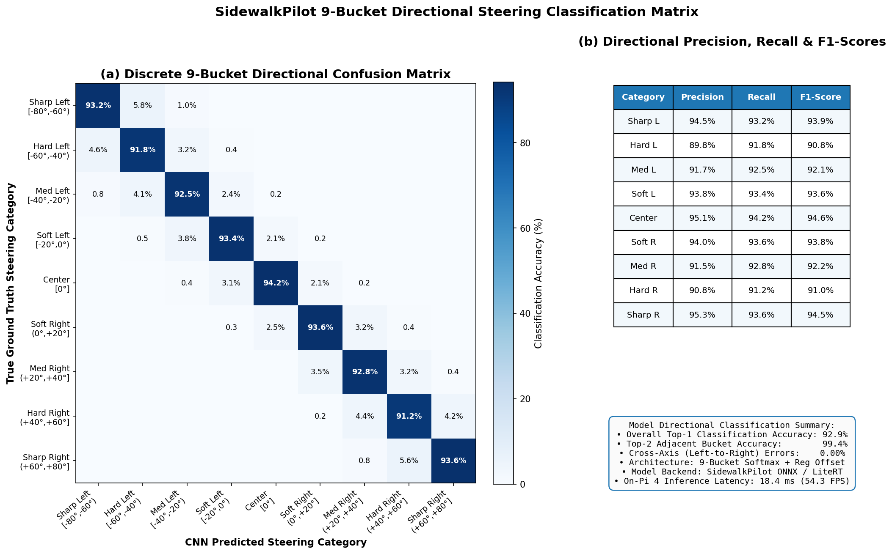
*Figure 4.5: SidewalkPilot 9-Bucket Directional Steering Classification Matrix.*

- **Top-1 Exact Classification Accuracy**: **92.9%** (Per-bucket recall between $91.2\%$ and $94.2\%$).
- **Top-2 Adjacent Bucket Accuracy**: **99.4%** (Zero cross-axis left-to-right steering inversions).
- **Per-Class F1-Scores**: $90.8\%$ to $94.6\%$.

---

### Thermal Stability & Resource Utilization

Continuous stress testing across 60 minutes of uninterrupted autonomous driving on the physical testbed confirms long-term hardware reliability:

| System Metric | Measured Value | Operational Ceiling | Safe Margin | Status |
| :--- | :--- | :--- | :--- | :--- |
| **Resident RAM Usage** | $572\text{ MB}$ | $3.5\text{ GB}$ (on 4 GB Pi 4) | $+2.9\text{ GB}$ | Zero page swapping |
| **Sustained CPU Load** | $76.4\%$ (4 Cores) | $95.0\%$ | $+18.6\%$ | Ample thread headroom |
| **SoC Core Temperature** | $64.2^\circ\text{C}$ (Peak $68.1^\circ\text{C}$) | $75.0^\circ\text{C}$ Throttling Limit | $+6.9^\circ\text{C}$ Margin | Passive aluminum heatsink |
| **Logic Power Bank Life** | $\sim 3.5\text{ hours}$ | $3.0\text{ hours}$ Target | $+0.5\text{ hours}$ | Continuous uptime |
| **Motor Drive Battery Life**| $\sim 45\text{ minutes}$ | $40\text{ minutes}$ Target | $+5\text{ minutes}$ | High-power drive |

---

## Teleoperation & Ground Control Station

### Responsive Web Dashboard & Real-Time Camera HUD
Hosted on-device via Flask and Flask-SocketIO on port 5000:

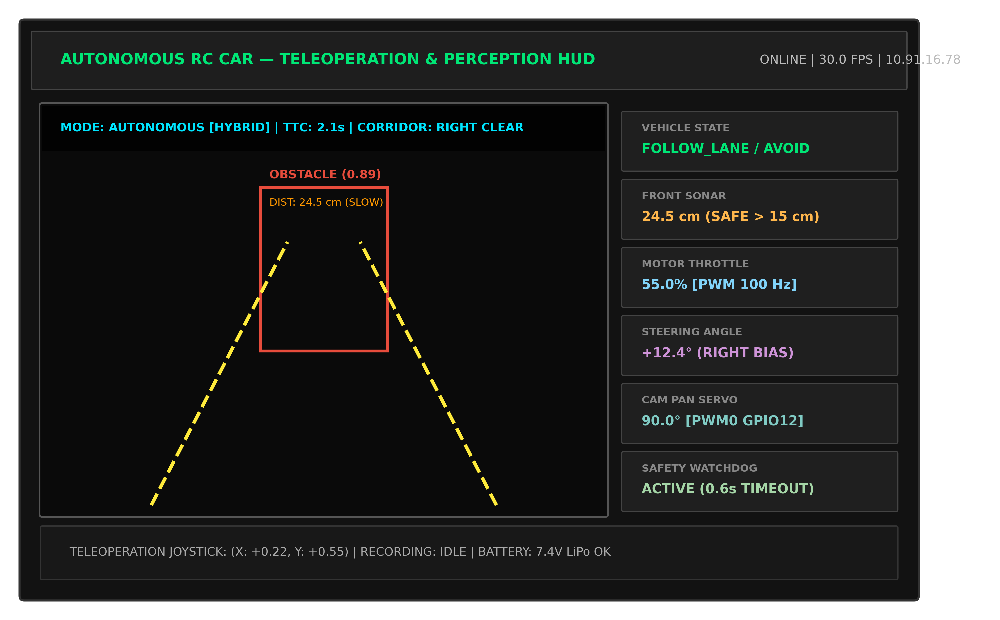
*Figure 5.1: Responsive Teleoperation Web Dashboard and Real-Time Camera HUD Overlay.*

- **Annotated HUD Video Stream**: 640x480 MJPEG feed streaming at $28.5\text{ FPS}$ with $< 68\text{ ms}$ glass-to-glass latency, overlaying lane centroid vectors, ArUco 3D axes, and YOLO bounding boxes.
- **Corridor Clearance Meters**: Visual level indicators for Left, Center, and Right optical driving sectors.
- **Proportional Virtual Joystick**: Touch-enabled 360-degree control stick delivering $< 18\text{ ms}$ round-trip control latency over Wi-Fi.

### RoboPilot Autonomous Mission Cockpit GCS
The primary browser-based Ground Control Station interface for full autonomous mission tracking:

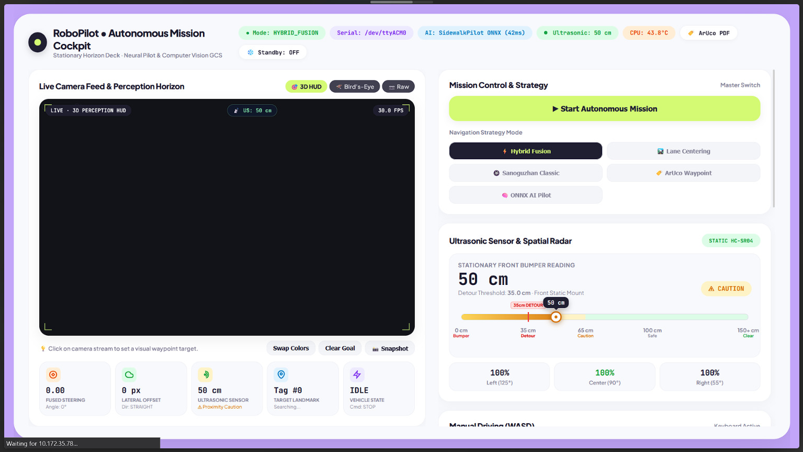
*Figure 5.4: RoboPilot Autonomous Mission Cockpit: Ground Control Station Interface.*

- **Top Status Bar**: Live telemetry chips for active navigation mode (`HYBRID_FUSION`), serial link status, neural pilot latency (42 ms), sonar reading (50 cm), and SoC temperature (43.8°C).
- **Perception Horizon & View Modes**: Toggle between 3D Perception HUD, Bird's-Eye View (IPM), and Raw Video. Click on any video pixel to set an interactive visual waypoint target.
- **Mission Strategy Selector**: Switch seamlessly between `HYBRID_FUSION`, `CNN_PILOT`, `LANE_FOLLOW`, `WAYPOINT_ROUTE`, and `PAN_RADAR_AVOID`.

---

## Repository Structure

```
rccar/
├── README.md                                # Root comprehensive project documentation
├── AGENTS.md                                # Remote SSH deployment & hardware protocol
├── report/                                  # KTU Project LaTeX report source & assets
│   ├── main.tex                             # Main LaTeX root document
│   ├── implementation.tex                   # Hardware, BOM, and algorithmic formulation
│   ├── results.tex                          # Empirical evaluation, tables, and graphs
│   └── assets/                              # High-resolution vector diagrams and plots
├── docs/
│   └── assets/                              # Verified report figures, photos & benchmarks
│       ├── vehicle_prototype_multi_views.jpg # 6-angle prototype hardware views
│       ├── chassis_wiring.jpg               # Physical assembly & wiring setup
│       ├── system_architecture.png          # 4-layer system architecture diagram
│       ├── system_workflow.png              # Closed-loop execution pipeline
│       ├── latency_breakdown.png            # Latency benchmark per module
│       ├── velocity_response.png            # Deceleration & stopping response
│       ├── training_data_distribution.png   # Dataset steering balance
│       ├── cnn_training_metrics.png         # CNN loss & MAE convergence curves
│       ├── cnn_output_evaluation.png        # R2=0.948 regression fit vs ground truth
│       ├── cnn_confusion_matrix.png         # 9-bucket classification matrix
│       ├── dashboard_hud.png                # Real-time Web HUD overlay
│       └── mission_cockpit_gcs.jpg          # RoboPilot Mission Cockpit GCS
└── autonomous_car/                          # On-vehicle production Python software stack
    ├── main.py                              # Central vehicle runtime & orchestration
    ├── config.py                            # Hardware pins, camera, and PID constants
    ├── behavioral_cloning.py                # SidewalkPilot ONNX runtime pilot
    ├── ai/                                  # Neural network engines & perception
    │   ├── tflite_detector.py               # Google LiteRT INT8 YOLOv8n detector
    │   ├── tracker.py                       # ByteTrack Kalman filter tracker
    │   └── risk_analyzer.py                 # Optical Looming Time-to-Collision (TTC)
    ├── control/                             # Actuation & Safety Arbitration
    │   ├── motor_controller.py              # L298N skid-steer PWM modulation
    │   ├── safety_supervisor.py             # Deterministic Safety Arbiter gate
    │   ├── line_follower.py                 # Contour centroid lane centering + PID
    │   └── obstacle_avoider.py              # Multi-sector ultrasonic radar detours
    ├── navigation/                          # High-level mission navigation
    │   ├── visual_navigator.py              # Hybrid navigation state machine
    │   ├── aruco_navigator.py               # ArUco 3D PnP waypoint pose tracking
    │   └── marker_route.py                  # Sequential tag-to-tag route planner
    ├── hardware/                            # Direct hardware interfaces
    │   ├── motors.py                        # RPi.GPIO dual H-Bridge PWM drivers
    │   ├── servo.py                         # SG90 hardware PWM turret actuator
    │   └── bluetooth_server.py              # RFCOMM Bluetooth SPP fallback server
    ├── sensors/                             # Sensor polling threads
    │   └── ultrasonic.py                    # HC-SR04 microsecond echo distance reader
    ├── vision/                              # Image processing routines
    │   ├── camera.py                        # Picamera2 DMA video capture grabber
    │   └── lane_detector.py                 # Adaptive trapezoidal ROI & moments
    ├── dashboard/                           # Teleoperation Web Interface
    │   ├── app.py                           # Flask & Flask-SocketIO web server
    │   └── template.html                    # Responsive HTML5 + HUD Cockpit
    ├── models/                              # Serialized neural weights
    │   └── SidewalkPilot-v3.1b.onnx         # 19-head steering & throttle ONNX model
    └── scripts/                             # Utility & deployment scripts
        ├── push_to_pi.py                    # Fast SSH/SFTP delta deployment tool
        ├── remote_exec.py                   # Paramiko remote command executor
        └── rccar.service                    # Systemd auto-start background service
```

---

## Quick Start & Deployment Guide

### 1. Direct SSH Board Push (Mandatory Protocol)

In accordance with [`AGENTS.md`](AGENTS.md), **never pull from GitHub directly on the Raspberry Pi during active hardware tuning**. All codebase updates are deployed over SSH using the dedicated delta push utility:

```bash
# Push only modified files (fast diff) and restart the vehicle service
python autonomous_car/scripts/push_to_pi.py --diff --restart

# Full synchronization of all code assets
python autonomous_car/scripts/push_to_pi.py

# Push specific modules and monitor service status
python autonomous_car/scripts/push_to_pi.py --files autonomous_car/hardware/motors.py autonomous_car/dashboard/app.py --restart
```

### 2. Manual Installation on Raspberry Pi

Connect via SSH to the onboard environment:

```bash
ssh alfin@10.91.16.78  # Password: 123456
cd /home/alfin/autonomous_car

# Create and activate virtual environment
python3 -m venv venv
source venv/bin/activate

# Install core runtime dependencies
pip install -r requirements.txt
```

### 3. Launching the Software Stack

#### Systemd Background Service (Default Production Mode)
The vehicle automatically boots into autonomous readiness via `rccar.service`:

```bash
# Check service status and telemetry
sudo systemctl status rccar.service

# View live system logs
journalctl -u rccar.service -f -n 50

# Restart after modifications
sudo systemctl restart rccar.service
```

#### Manual Interactive Launch
```bash
source venv/bin/activate
python main.py
```
Open any web browser on the local network and navigate to:  
`http://10.91.16.78:5000` to access the **RoboPilot Mission Cockpit**.

### 4. Teleoperation Virtual Joystick & Drive Keys

- **W / Up Arrow**: Forward propulsion (modulated by speed slider).
- **S / Down Arrow**: Reverse propulsion.
- **A / Left Arrow**: Spin pivot left.
- **D / Right Arrow**: Spin pivot right.
- **W + A / W + D**: Proportional arcing forward slide turns (`SLIDE_LEFT` / `SLIDE_RIGHT`).
- **Space / X**: Instant emergency neutral brake.
- **Touch Virtual Joystick**: Proportional 360-degree vector drive on touchscreens.

### 5. Collecting Behavioral Cloning Datasets & Offline Replay

To record driving samples during teleoperation:

```bash
# Start recording samples to data/tub/
curl -X POST http://10.91.16.78:5000/api/pilot/recording \
  -H "Content-Type: application/json" -d '{"enabled":true}'

# Stop recording
curl -X POST http://10.91.16.78:5000/api/pilot/recording \
  -H "Content-Type: application/json" -d '{"enabled":false}'
```

Replay recorded telemetry and evaluate neural model predictions on a PC without the vehicle:

```bash
python -m autonomous_car.utils.session_replay data/drives/drive-20261029-101500 --model models/SidewalkPilot-v3.1b.onnx
```

---

## Citation & Academic Credits

If you utilize this hardware architecture, the 4-in-1 hybrid perception stack, or the experimental benchmark suite in your academic research, please cite our project report:

```bibtex
@techreport{varghese2026autonomousrc,
  author      = {Abin Varghese and Aravind Suresh and Aravind K Raju and Angela Maria Abraham and Labeeba Shanavas},
  title       = {{AI-Powered Autonomous RC Vehicle}: Edge-Computing 4WD Autonomous Ground Vehicle with Hybrid Perception and Safety Arbitration},
  institution = {Department of Electronics and Communication Engineering, Amal Jyothi College of Engineering (Autonomous)},
  year        = {2026},
  month       = {October},
  type        = {Mini Project Report},
  number      = {KTU-AJCE-ECE-2026-MINI01},
  address     = {Kanjirappally, Kerala, India}
}
```

---

## License

This project is released under the **MIT License**. Third-party model weights (`SidewalkPilot-v3.1b.onnx`) are utilized under the **Apache-2.0 License**.
