<p align="center">
  
</p>

<p align="center">
  <strong>Complete Autonomous RC Car Software Stack for Raspberry Pi 4: Real-Time Computer Vision, YOLOv8 AI, Lane Keeping, PID Steering, Dual Ultrasonics, and Arduino Serial Telemetry</strong>
</p>

<p align="center">
  <a href="https://github.com/AbinVarghexe/rccar/blob/master/LICENSE"></a>
  <a href="https://www.python.org/downloads/release/python-3110/"></a>
  <a href="https://www.raspberrypi.com/products/raspberry-pi-4-model-b/"></a>
  <a href="https://www.arduino.cc/"></a>
  <a href="https://opencv.org/"></a>
  <a href="https://docs.ultralytics.com/"></a>
</p>

---

## Overview

**rccar** is a modular, production-grade autonomous ground vehicle software stack designed for 1:10 scale RC platforms powered by a **Raspberry Pi 4B** companion computer and an **Arduino UNO** motor controller.

The architecture decouples high-level perception (Picamera2 video acquisition, contour centroid lane detection, ByteTrack object tracking, and YOLOv8 obstacle classification) from low-level real-time actuation (discrete anti-windup PID steering and dual HC-SR04 ultrasonic collision avoidance) over high-speed USB-UART serial.

```
       +--------------------------------------------------------+
       |             Perception & Decision (Raspberry Pi 4B)    |
       |                                                        |
       |  +--------------------+         +-------------------+  |
       |  | Picamera2 CSI Feed |         | Dual HC-SR04 Echo |  |
       |  +---------+----------+         +---------+---------+  |
       |            |                              |            |
       |            v                              v            |
       |  +--------------------+         +-------------------+  |
       |  | Vision & Lane Track|         | Distance Monitor  |  |
       |  | - Centroid ROI     |         | - Front Warning   |  |
       |  | - Junction Detect  |         | - Emergency Stop  |  |
       |  +---------+----------+         +---------+---------+  |
       |            |                              |            |
       |            v                              v            |
       |  +--------------------------------------------------+  |
       |  | Navigation State Machine & Anti-Windup PID       |  |
       |  +-------------------------+------------------------+  |
       +----------------------------|---------------------------+
                                    | High-Speed Serial UART
                                    v
       +--------------------------------------------------------+
       |             Actuation & Control (Arduino UNO)          |
       |                                                        |
       |  - 4WD H-Bridge Motor Driver (L298N / TB6612)          |
       |  - Front Steering Servo (PWM Angle Mapping)            |
       |  - Fail-safe Heartbeat Watchdog                        |
       +--------------------------------------------------------+
```

---

## Key Subsystems

### 1. Vision & Lane Tracking (`autonomous_car/vision/`)
- **Native Picamera2 Integration**: Hardware-accelerated camera capture with automatic fallback to standard OpenCV video capture on desktop dev systems.
- **Centroid Lane Tracking**: Dynamic Region of Interest (ROI) slicing, adaptive binary thresholding, and contour centroid computation.
- **Junction Recognition**: Automated classification of left-turn, right-turn, T-junctions, cross-sections, and dead-ends.

### 2. Edge AI & Hazard Estimation (`autonomous_car/ai/`)
- **YOLOv8 Inference**: Real-time bounding box detection filtered for road hazards (pedestrians, vehicles, stop signs).
- **ByteTrack Tracking**: Assigns persistent track IDs across frames to measure spatial velocity and looming Time-To-Collision (TTC).
- **Corridor Scanning**: Sector-based clearance evaluation determining navigable escape vectors.

### 3. Control & Serial Link (`autonomous_car/control/`)
- **Discrete PID Controller**: Proportional-Integral-Derivative steering law with integral anti-windup clamp to eliminate lane overshoot.
- **Serial Protocol**: Clean ASCII byte command packet protocol (`F:speed`, `B:speed`, `S:angle`, `STOP`) communicated over `/dev/ttyACM0` or `/dev/ttyUSB0`.

### 4. Telemetry Web Dashboard (`autonomous_car/dashboard/`)
- Built-in Flask telemetry server streaming live camera feeds with HUD overlay, ultrasonic telemetry gauges, state machine transitions, and manual emergency override controls.

---

## Hardware Bill of Materials (BOM)

| Component | Specification | Function |
| :--- | :--- | :--- |
| **SBC** | Raspberry Pi 4 Model B (4GB+) | High-level vision, state machine, AI inference |
| **Microcontroller** | Arduino UNO Rev 3 | Low-level PWM motor & servo driving |
| **Camera** | Raspberry Pi Camera Module V2 / V3 | 1080p CSI-2 wide-angle video acquisition |
| **Chassis & Motors** | 4WD Aluminum Robot Chassis + 4x TT DC Motors | Physical platform and drivetrain |
| **Motor Driver** | L298N Dual H-Bridge Driver | High-current DC motor speed and direction |
| **Steering Servo** | MG996R High-Torque Metal Gear Servo | Front wheel steering rack angle |
| **Distance Sensors**| 2x HC-SR04 Ultrasonic Transceivers | Forward and rearward proximity safety stops |
| **Power Supply** | 5V 3A USB-C Power Bank + 7.4V 2S LiPo | Dual-rail isolated SBC and motor power |

---

## Quick Start Guide

### 1. Raspberry Pi Setup

```bash
# Clone the repository
git clone https://github.com/AbinVarghexe/rccar.git
cd rccar/autonomous_car

# Run the automated installer script
chmod +x setup.sh run.sh
./setup.sh
```

### 2. Starting the Autonomous Stack

```bash
# Launch the full autonomous driver loop
./run.sh
```

### 3. Accessing the Live Dashboard

Navigate to `http://<raspberry_pi_ip>:5000` from any device connected to the vehicle's Wi-Fi hotspot to monitor telemetry and camera footage.

---

## Repository Tree

```
rccar/
├── assets/
│   └── banner.svg               # Vector visual banner
├── autonomous_car/
│   ├── ai/                      # YOLOv8 detector, ByteTrack, risk analysis
│   ├── control/                 # PID controller, PySerial Arduino bridge
│   ├── dashboard/               # Flask live web interface and HUD
│   ├── hardware/                # Motor, servo, and bluetooth primitives
│   ├── navigation/              # State machine, waypoint planner
│   ├── sensors/                 # Dual HC-SR04 ultrasonic drivers
│   ├── vision/                  # Picamera2 pipeline, lane/junction detector
│   ├── config.py                # Tuning constants, thresholds, pins
│   ├── main.py                  # Thread coordinator & orchestrator
│   └── requirements.txt         # Dependencies (opencv, ultralytics, pyserial)
└── README.md                    # System documentation
```

## License

This project is licensed under the MIT License - see the [LICENSE](LICENSE) file for details.
