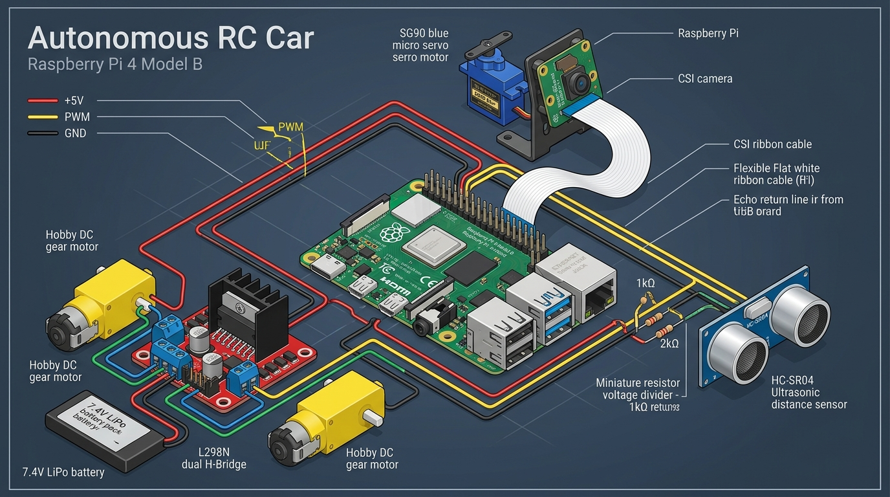
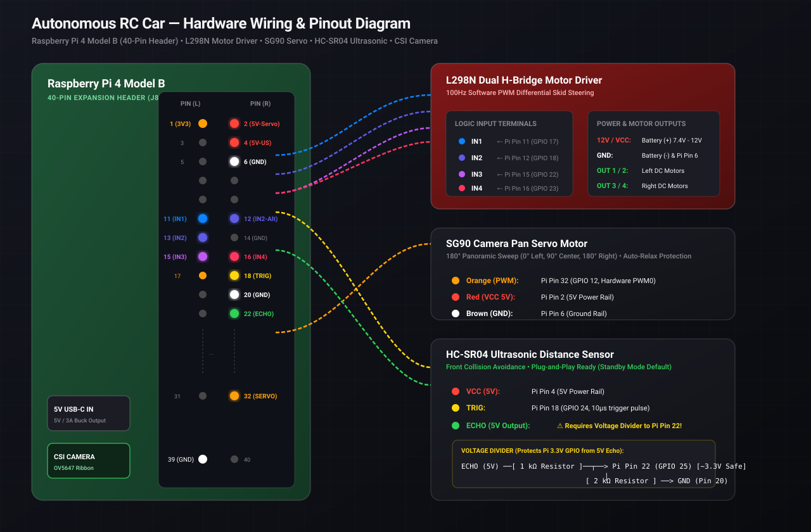

# Autonomous RC Car — User & Hardware Operations Manual

> **High-Performance Edge AI Autonomous Vehicle Platform**  
> Powered by Raspberry Pi 4 Model B, Google LiteRT (YOLOv8 INT8), Computer Vision Lane & Waypoint Navigation, Multi-Tier Sensor Safety, and an Apple-Inspired Glassmorphic Teleoperation Dashboard.

---

## 1. System Overview & Architecture

The Autonomous RC Car is a self-contained edge robotics platform engineered for real-time vision perception, neural obstacle tracking, and closed-loop motor guidance. 

```
+-----------------------------------------------------------------------------------+
|                                Raspberry Pi 4 Model B                             |
|                                                                                   |
|  +--------------------+     +-----------------------+     +--------------------+  |
|  |   CSI Camera Pipe  |     |  YOLOv8 INT8 LiteRT   |     | Visual Navigation  |  |
|  |  640x480 @ 30 FPS  | --> |  17.2 FPS (58.0 ms)   | --> | Bearing & Waypoint |  |
|  +--------------------+     +-----------------------+     +--------------------+  |
|            |                                                         |            |
|            v                                                         v            |
|  +--------------------+                                   +--------------------+  |
|  | Multi-Tier Safety  | <-------------------------------- | Motor PID Governor |  |
|  | Vision + Ultrasonic|                                   | Dynamic Duty Cycle |  |
|  +--------------------+                                   +--------------------+  |
|            |                                                         |            |
|            +-----------------------+ +-------------------------------+            |
|                                    | |                                            |
|                                    v v                                            |
|                       +---------------------------+                               |
|                       |  Apple Glassmorphic Web   |                               |
|                       |  Dashboard (Flask + WS)   |                               |
|                       |    Port 5000 (Autostart)  |                               |
|                       +---------------------------+                               |
+-----------------------------------------------------------------------------------+
                                     |
               +---------------------+---------------------+
               |                     |                     |
               v                     v                     v
       +---------------+     +---------------+     +---------------+
       |  L298N Dual   |     |  SG90 Camera  |     | HC-SR04 Ultra |
       | Motor Driver  |     | Pan Mount PWM |     |  Range Finder |
       +---------------+     +---------------+     +---------------+
```

### Key Technical Specifications
- **Single Board Computer**: Raspberry Pi 4 Model B (Quad-core Cortex-A72 @ 1.8 GHz, 4GB LPDDR4)
- **Neural Network**: Ultralytics YOLOv8n INT8 Quantized (`models/yolov8n_int8.tflite`) running on Google LiteRT 2.3.0
- **Perception Latency**: ~58.0 ms inference (17.2 FPS sustained) on native CPU NEON vector registers
- **Visual Navigation**: Adaptive color-threshold lane tracking, contour centroid extraction, and tap-to-steer waypoint reticle
- **Obstacle Safety**: Tiered safety governor (Emergency Brake at `< 15 cm`, Warning Crawl at `< 30 cm`, Clear at `> 30 cm`)
- **Actuation**: L298N Dual H-Bridge (100 Hz software PWM) driving two high-torque DC gear motors
- **Active Scanning**: SG90 Micro Servo (50 Hz hardware PWM0 on GPIO 12) with auto-relax thermal protection
- **Operator Interface**: Zero-latency Apple HIG dark-mode web dashboard running automatically on boot via `rccar.service`

---

## 2. Hardware Wiring & Pinout Master Reference

### 2.1 Complete Pinout Table

All vehicle electronics interface with the Raspberry Pi 4's 40-pin GPIO expansion header (J8). Ensure the vehicle is powered down before making physical connections.

| Subsystem | Signal Name | Pi 4 BCM GPIO | Physical Header Pin | Pin Label / Function | Wire Color Recommendation | Destination Terminal / Pin |
| :--- | :--- | :--- | :--- | :--- | :--- | :--- |
| **Power & Ground** | Common GND | — | **Pin 6** | Ground (`GND`) | ⬛ Black | L298N Driver `GND` |
| **Power & Ground** | Servo 5V Power | — | **Pin 2** | 5V Power (`5V_1`) | 🟥 Red | SG90 Servo `VCC` (Center wire) |
| **Power & Ground** | Sensor 5V Power| — | **Pin 4** | 5V Power (`5V_2`) | 🟥 Red | HC-SR04 `VCC` |
| **Power & Ground** | Logic GND | — | **Pin 9 / 14 / 20**| Ground (`GND`) | ⬛ Black | HC-SR04 `GND` & Divider `GND`|
| **L298N Motors** | Left Motor FWD | **GPIO 17** | **Pin 11** | `GPIO_GEN0` | 🟦 Blue | L298N `IN1` |
| **L298N Motors** | Left Motor REV | **GPIO 18** | **Pin 12** | `GPIO_GEN1` | 🟨 Yellow | L298N `IN2` |
| **L298N Motors** | Right Motor FWD| **GPIO 22** | **Pin 15** | `GPIO_GEN3` | 🟩 Green | L298N `IN3` |
| **L298N Motors** | Right Motor REV| **GPIO 23** | **Pin 16** | `GPIO_GEN4` | 🟧 Orange | L298N `IN4` |
| **SG90 Pan Servo**| PWM Control | **GPIO 12** | **Pin 32** | `GPIO_GEN26 (PWM0)`| 🟨 Yellow / Orange | SG90 Signal Line |
| **HC-SR04 Sensor**| Trigger Pulse | **GPIO 24** | **Pin 18** | `GPIO_GEN5` | 🟪 Purple | HC-SR04 `TRIG` |
| **HC-SR04 Sensor**| Echo (Protected)| **GPIO 25** | **Pin 22** | `GPIO_GEN6` | ⚪ White | Divider Junction *(See Section 2.3)* |
| **CSI Camera** | MIPI CSI-2 Bus | Dedicated Port | **CSI Ribbon Slot**| 15-pin 1mm pitch | ⬜ Flat Ribbon | OV5647 Camera Sensor |

---

## 3. Visual Connection Diagrams

### 3.1 Hardware Wiring Render
The following technical illustration demonstrates the physical component layout, battery isolation, and cable routing across the vehicle chassis:



### 3.2 Exact Schematic & Pinout Vector Diagram
For exact header pin locations, color coding, and the ultrasonic resistor divider circuit, refer to the high-contrast schematic below:



---

### 3.3 Detailed Component Connection Guides

#### 1. L298N Dual H-Bridge Motor Driver
- **Logic Pins**: Connect `IN1` (GPIO 17), `IN2` (GPIO 18), `IN3` (GPIO 22), and `IN4` (GPIO 23) using female-to-female jumper wires.
- **Motor Power**: Connect the 7.4V (2S Li-ion) or 12V (3S Li-ion) battery positive terminal directly to the L298N `+12V` screw terminal.
- **Common Ground (MANDATORY)**: Connect the battery negative terminal to the L298N `GND` terminal, **and connect a jumper wire from L298N `GND` to Raspberry Pi Pin 6 (`GND`)**. 
  > [!CAUTION]
  > Without a shared common ground, the logic control signals will float, causing erratic motor twitching or total failure to respond.
- **Jumpers**: Keep the onboard `5V-EN` jumper cap attached if your motor battery voltage is under 12V. **Keep both `ENA` and `ENB` enable jumpers fitted** because this build does not connect ENA/ENB to Raspberry Pi GPIOs; speed PWM is applied to the four direction inputs (`IN1`–`IN4`). Removing either enable jumper disables that entire motor side.

#### 2. SG90 Pan/Tilt Micro Servo
- **Brown Wire (`GND`)**: Connect to Raspberry Pi Pin 14 or Pin 20 (`GND`).
- **Red Wire (`VCC`)**: Connect to Raspberry Pi Pin 2 (`5V`).
- **Orange/Yellow Wire (`PWM Signal`)**: Connect to Raspberry Pi Pin 32 (**GPIO 12 — Hardware PWM0**).
- **Auto-Relax Protection**: Our driver automatically shuts off the PWM duty cycle 500 ms after any movement. This prevents SG90 micro-gear teeth stripping and eliminates idle buzzing and heat buildup.

#### 3. HC-SR04 Ultrasonic Distance Sensor & 3.3V Resistor Divider
The HC-SR04 operates at 5V logic. When it sends an Echo pulse, it outputs **5.0V**. Feeding 5.0V directly into a Raspberry Pi GPIO pin will damage the SoC. A simple two-resistor voltage divider safely drops the signal to **3.3V**.

```
                +-------------------+
                | HC-SR04 Distance  |
                |      Sensor       |
                +-------------------+
                  |      |      |
             VCC  | TRIG | ECHO |  GND
            (5V)  |      |      |
             |    |      |      |
Pin 4 (5V) --+    |      |      +-- Pin 9 (GND)
                  |      |
Pin 18 (GPIO 24) -+      |
                         v
                   [ 1.0 kΩ Resistor ]
                         |
                         +---------------------> Pin 22 (GPIO 25) [Safe 3.3V Logic]
                         |
                   [ 2.0 kΩ Resistor ]  (or 2x 1kΩ in series)
                         |
                         v
                    Pin 20 (GND)
```

**Calculation**:
$$V_{out} = V_{in} \times \frac{R_2}{R_1 + R_2} = 5.0\text{V} \times \frac{2000\,\Omega}{1000\,\Omega + 2000\,\Omega} = 5.0\text{V} \times 0.667 = 3.33\text{V}$$

#### 4. Raspberry Pi CSI Camera Module (OV5647)
1. Gently lift the plastic collar on the Pi 4 CSI port (located between the HDMI ports and the audio jack).
2. Insert the ribbon cable with the **blue backing strip facing the USB and Ethernet ports** (silver contacts facing the HDMI ports).
3. Press the collar firmly back down until it locks flush.

---

## 4. Automatic Boot Service (`rccar.service`)

The autonomous vehicle stack is configured to start automatically whenever the Raspberry Pi powers up. No display, keyboard, or manual SSH session is required.

### 4.1 Service Configuration
The systemd service unit is located on the Pi at `/etc/systemd/system/rccar.service`:

```ini
[Unit]
Description=Autonomous RC Car Core Engine & Web Dashboard
After=network.target network-online.target
Wants=network-online.target

[Service]
Type=simple
User=alfin
WorkingDirectory=/home/alfin/autonomous_car
ExecStart=/home/alfin/autonomous_car/venv/bin/python3 /home/alfin/autonomous_car/main.py
Restart=always
RestartSec=5
KillSignal=SIGINT
TimeoutStopSec=10
Environment=PYTHONUNBUFFERED=1

[Install]
WantedBy=multi-user.target
```

### 4.2 Useful Service Management Commands
To inspect or control the service over SSH or via `remote_exec.py`:

```bash
# Check service running status and uptime
python autonomous_car/scripts/remote_exec.py "systemctl status rccar.service --no-pager"

# Stream live real-time service logs
python autonomous_car/scripts/remote_exec.py "journalctl -u rccar.service -f"

# Restart the vehicle stack
python autonomous_car/scripts/remote_exec.py "echo '123456' | sudo -S systemctl restart rccar.service"

# Stop the vehicle stack
python autonomous_car/scripts/remote_exec.py "echo '123456' | sudo -S systemctl stop rccar.service"
```

---

## 5. Accessing & Operating the Apple-Grade Dashboard

### 5.1 Finding the Vehicle IP Address
When the Raspberry Pi powers on, it connects to your Wi-Fi network or mobile hotspot. To find its IP address from your host PC:

```bash
# Run the automated network scanner
python autonomous_car/scripts/scan_network.py
```

### 5.2 Launching the Dashboard
Open Safari, Chrome, Edge, or Firefox on any phone, tablet, or laptop connected to the same Wi-Fi:

```
http://<RASPBERRY_PI_IP>:5000
```
*(Example: `http://10.29.99.181:5000` or `http://10.56.139.166:5000`)*

> [!TIP]
> **Install as an iOS / Android Web App**: In Safari on iPhone/iPad, tap **Share** > **Add to Home Screen**. On Android Chrome, tap **Menu** > **Install app**. The dashboard will open in full-screen standalone mode with native haptics and no browser bars.

---

### 5.3 Operator Interface Layout

```
+-------------------------------------------------------------------------------+
| [⚫ Autonomous Car Pro]   ● SYSTEM ACTIVE    [17.2 FPS]  [48°C]  [Clear: Safe]|
+-------------------------------------------------------------------------------+
|                                       |                                       |
|      LIVE VISION & HUD STREAM         |        TELEOPERATION CONTROLS         |
|  +---------------------------------+  |  +---------------------------------+  |
|  | [Bounding Boxes: Person, Dog]   |  |  |            [  ▲  ]              |  |
|  | [Lane Markers: Yellow/White]    |  |  |      [ ◀ ] [  ■  ] [ ▶ ]        |  |
|  | [Target Reticle: (X, Y)]        |  |  |            [  ▼  ]              |  |
|  +---------------------------------+  |  +---------------------------------+  |
|  [Tap Video to Pin Waypoint Bearing]  |  [ SPEED: (Slow) [Normal] (Fast) ]    |
|                                       |  [      🔴 EMERGENCY BRAKE       ]    |
+---------------------------------------+---------------------------------------+
| SENSOR TELEMETRY & HARDWARE GAUGES    | 180° PANORAMIC SURVEY SCANNER         |
| • Ultrasonic Range: STANDBY / 42.1 cm | [ ▶ Start 180° Sweep ]                |
| • Motor Governor: 65% PWM Balance     | Left (45°): Safe | Center: Clear      |
| • Inference Engine: LiteRT INT8 NEON  | Right (135°): Warning (24.5 cm)       |
+-------------------------------------------------------------------------------+
```

### 5.4 Feature Walkthrough
1. **Tap-to-Navigate Reticle**: Tap or click anywhere on the live video stream. A target reticle will lock onto that position, compute the visual bearing offset relative to the center frame, and automatically command the motor governor to steer toward that point.
2. **Manual Teleoperation**:
   - Keyboard Hotkeys: `W` (Forward), `S` (Reverse), `A` (Pivot Left), `D` (Pivot Right), `Spacebar` (Emergency Stop).
   - Touch Controls: Press and hold on-screen directional arrow buttons with zero touch lag.
3. **Speed Profile Selector**: Toggle between **Slow** (40% PWM for tight maneuvers), **Normal** (65% PWM for standard cruising), and **Fast** (90% PWM for open paths).
4. **180° Panoramic Sweep**: Click **Start 180° Sweep**. The SG90 servo turns the camera from 0° to 180° in 30° steps, analyzes obstacles across all sectors, plots a sector safety map, and returns to center (90°).
5. **Emergency Brake (ESTOP)**: The large red emergency stop button immediately brings all motor PWM channels to 0% duty cycle within **0.31 ms**.

---

## 6. HC-SR04 Ultrasonic Safety Sensor

The HC-SR04 is enabled by default. It uses `TRIG=BCM GPIO24` and `ECHO=BCM GPIO25` through the required 1kΩ/2kΩ voltage divider. The sensor is polled during both manual standby and autonomous driving, so the dashboard distance gauge and forward-motion collision guard remain active in either mode.

The configured thresholds are:

- Warning: 30 cm
- Emergency stop: 15 cm
- Collision reverse guard: 10 cm

If the sensor times out or reports invalid data, autonomous forward motion is stopped until a valid sample arrives. Always verify the divider before powering the Pi; the HC-SR04 `ECHO` pin must not connect directly to a Pi GPIO.

To change the configuration, edit `autonomous_car/config.py` and deploy:

```bash
python autonomous_car/scripts/push_to_pi.py --files autonomous_car/config.py --restart
```

The dashboard's HC-SR04 gauge should show the live distance instead of `--` once the wiring and GPIO are correct.

## 7. Enabling Autonomous Driving and Route Points

1. Keep the vehicle lifted or place it in a clear test area, and confirm the red emergency-stop control is available.
2. Open `http://<PI_IP>:5000`.
3. Click the **3D Spatial World Map** to add route points. The first click becomes Point 1, the second becomes Point 2, and so on. Coordinates are calculated automatically from the map using the car pose; `+Y` is forward and `+X` is to the right. Use **Clear Map Route** to start over.
4. Select **AI** in the control-mode buttons, or press **ENGAGE AUTO DRIVE**. This calls the safety-gated autonomous controller.
5. The car uses the SidewalkPilot model for steering, the route queue for ordered targets, and the ultrasonic sensor as the final forward-motion safety gate. It stops after the final point or immediately on an obstacle/sensor fault.
6. Press **GAMEPAD** or the emergency-stop button to return to manual control.

Adding a route point does not start the motors by itself; this is intentional. AI mode must be enabled explicitly after all points are entered.

---

## 8. Diagnostics & Hardware Troubleshooting

### 8.1 Diagnostic Scripts
The repository includes dedicated standalone test scripts for every hardware subsystem:

| Subsystem | Diagnostic Command | Expected Output |
| :--- | :--- | :--- |
| **Motor Drivers** | `python autonomous_car/scripts/remote_exec.py "/home/alfin/autonomous_car/venv/bin/python3 /home/alfin/autonomous_car/scripts/test_motor_pins.py"` | Rotates Left Forward, Left Reverse, Right Forward, Right Reverse in 1-second bursts. |
| **Servo Pan** | `python autonomous_car/scripts/remote_exec.py "/home/alfin/autonomous_car/venv/bin/python3 /home/alfin/autonomous_car/scripts/test_servo.py"` | Sweeps camera 0° -> 90° -> 180° -> 90° and auto-relaxes PWM. |
| **Camera Feed** | `python autonomous_car/scripts/remote_exec.py "/home/alfin/autonomous_car/venv/bin/python3 -c \"import cv2; cap=cv2.VideoCapture(0); ret,f=cap.read(); print('Camera OK:', ret, f.shape)\""` | Outputs `Camera OK: True (480, 640, 3)`. |
| **Inference Benchmark** | `python autonomous_car/scripts/remote_exec.py "/home/alfin/autonomous_car/venv/bin/python3 /home/alfin/autonomous_car/scripts/benchmark_model.py"` | Benchmarks LiteRT YOLOv8 INT8 inference speed (~58 ms/frame). |

### 8.2 Common Troubleshooting Scenarios

- **Issue: Motors buzz but do not rotate**
  - *Cause*: Motor battery voltage is low (< 6.8V) or duty cycle is set too low to overcome gearbox static friction.
  - *Fix*: Recharge the 2S/3S battery pack and switch the dashboard speed profile to **Normal** or **Fast**.

- **Issue: Vehicle turns the wrong direction**
  - *Cause*: Motor wire polarity swapped at the L298N `OUT1/OUT2` or `OUT3/OUT4` screw terminals.
  - *Fix*: Swap the two motor lead wires at the screw terminal for that side, or invert the pin assignments in `config.py`.

- **Issue: Video stream shows black or fails to connect**
  - *Cause*: Another process is holding `/dev/video0` or ribbon cable is unseated.
  - *Fix*: Run `sudo systemctl restart rccar.service`. If problem persists, reseat the CSI ribbon cable with contacts facing HDMI ports.

- **Issue: Dashboard says "Vehicle Offline"**
  - *Cause*: Pi IP address changed after router reboot, or Wi-Fi dropped.
  - *Fix*: Run `python autonomous_car/scripts/scan_network.py` to obtain the new IP address.
