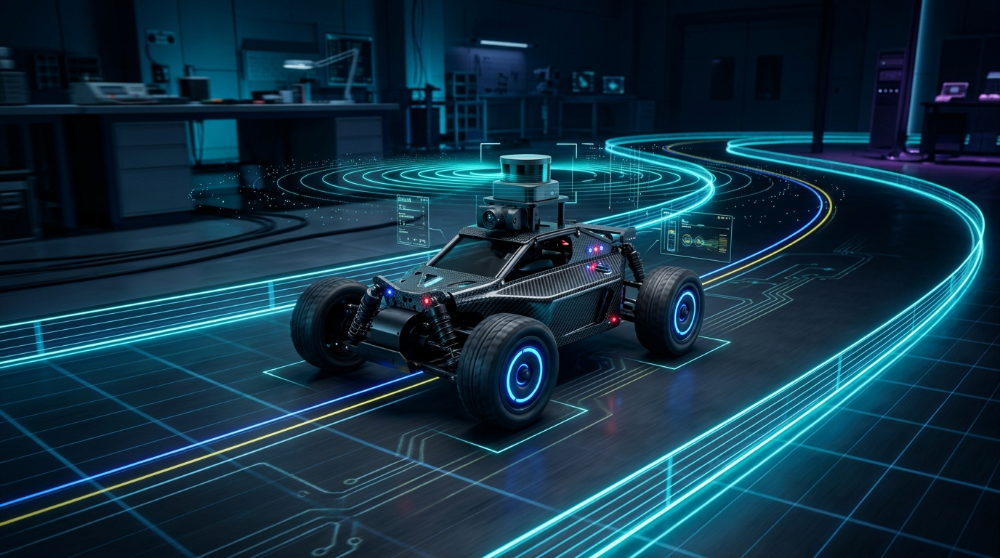
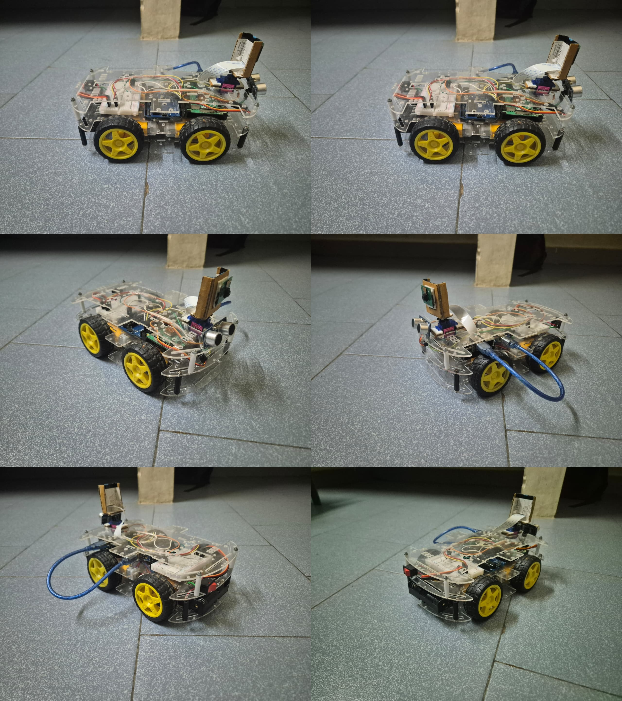
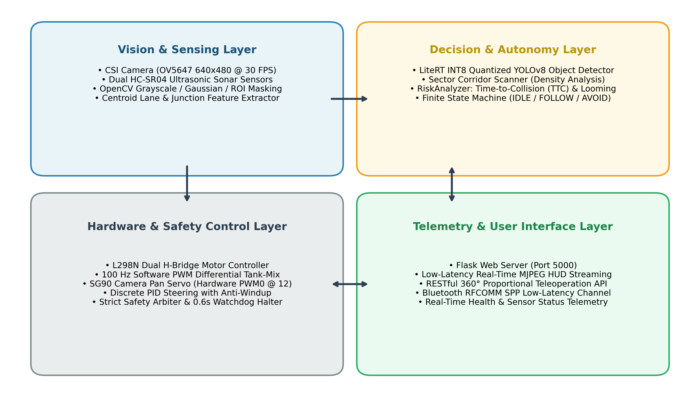

<div align="center">



# AI-Powered Autonomous RC Vehicle — Autonomous Stack

[](../README.md)
[](https://www.raspberrypi.com/)
[](../README.md#4-in-1-hybrid-perception-and-navigation-engine)
[-green.svg)](../README.md#deep-behavioral-cloning-pilot)
[-orange.svg)](../README.md#empirical-latency-benchmarks)

</div>

> **Autonomous Stack & Runtime Documentation**  
> For the comprehensive KTU Academic Project Report, full mathematical formulation, experimental benchmarks, and hardware schematics, refer to the [Root Project README](../README.md).


*Physical 4WD vehicle prototype testbed from multiple viewing angles.*

---

## 4-in-1 Hybrid Perception & Runtime Overview

The vehicle runtime executes an integrated 4-in-1 hybrid autonomy pipeline:
1. **Classical Computer Vision**: Adaptive trapezoidal contour centroid extraction ($C_x = M_{10}/M_{00}$) with discrete anti-windup PID control running at 30 FPS / 6.4 ms.
2. **ArUco 3D Waypoint Navigation**: Metric Levenberg-Marquardt Perspective-n-Point ($PnP$) 6-DoF pose estimation at 30 FPS / 12.3 ms.
3. **Deep Behavioral Cloning Pilot**: Real-time on-device inference using the Apache-2.0 SidewalkPilot-v3.1b ONNX model evaluated via ONNX Runtime with ARM NEON SIMD at 20 Hz / 48.2 ms.
4. **Quantized Object Detection & Tracking**: Asynchronous Google LiteRT INT8 YOLOv8n detector at 5 Hz (106.4 ms) paired with ByteTrack Kalman filter tracking at 30 Hz (3.8 ms).
5. **Deterministic Multi-Tier Safety Arbiter**: Hardware acoustic range gate (30 cm warning, 15 cm stop, 10 cm reverse counter-pulse) + optical Looming Time-to-Collision ($\tau \le 1.2\text{ s}$), achieving 100% collision avoidance across 60 empirical trials.


*Figure 3.1: Multi-Layer System Architecture of the Autonomous Vehicle.*

---

## Behavioral-Cloning Autonomous RC Car Software Stack

The behavioral cloning runtime follows an edge-adapted workflow: drive in
manual mode to collect camera frames with steering/throttle labels, train a
pilot model in Google Colab, then run that model locally on the Raspberry Pi.

Use `POST /api/pilot/recording` with `{"enabled": true}` while driving to save
training samples under `data/tub`. The default pilot is the Apache-2.0
SidewalkPilot-v3.1b ONNX model, stored at
`models/SidewalkPilot-v3.1b.onnx`. It accepts a 320x180 BGR frame and emits
bucketed 0-180 degree steering plus throttle. Select `local_angle` for learned
steering with a constant safe throttle or `local_pilot` for learned steering
and throttle.

## DeepPiCar implementation

This is an adaptation of the linked DeepPiCar workflow, not a hardware-copy:
manual driving produces labeled camera frames, an off-board CNN is trained,
and the trained pilot is then run locally on the Raspberry Pi. The runtime
keeps the existing motor, camera, and dashboard interfaces and adds a local
safety gate before every learned command.

The data collector writes one session directory under `data/tub/` containing
JPEG frames, `labels.csv`, and `metadata.jsonl`. Each label uses normalized
values: steering `-1..1` (left to right) and throttle `-1..1` (reverse to
forward). Start and stop collection with:

```bash
curl -X POST http://<pi-ip>:5000/api/pilot/recording \
  -H "Content-Type: application/json" -d '{"enabled":true}'
curl -X POST http://<pi-ip>:5000/api/pilot/recording \
  -H "Content-Type: application/json" -d '{"enabled":false}'
```

The local model comes from
https://huggingface.co/ram-shreyas-naik-sabavat/SidewalkPilot-v3.1b. A missing
or unloadable model always results in STOP; it never causes the car to drive
open-loop. The model is intended for controlled RC-car experiments and still
requires local camera calibration and supervised wheel-up testing.

## Latency, drive logs and offline replay

`GET` status now includes `stage_latency_ms` (avg / p95 / max per stage:
`capture`, `inference`, `safety`, `motor`) so slow stages are visible.

Set `behavioral_cloning.telemetry_enabled = True` (or send
`telemetry_enabled` through the pilot config params) to log every autonomous
run to `data/drives/drive-*/telemetry.jsonl`: model output, the command that
reached the motors, the safety reason, sonar, frame age and stage timings,
plus a JPEG every `telemetry_frame_every` rows. Logging stops on its own when
free disk space falls below 200 MB. Manual `data/tub` sessions also store
sonar and frame age in `metadata.jsonl` (`labels.csv` is unchanged).

Copy a session to a PC and replay it without the car:

```bash
python -m utils.session_replay data/drives/drive-20261029-101500
python -m utils.session_replay data/drives/drive-... --model models/new.onnx
python -m utils.session_replay data/drives/drive-... --no-model --stop-cm 12
```

The report shows how a model agrees with the logged steering, and how many
forward requests the safety supervisor would have stopped under the
thresholds you pass. Inference times from a PC are not Pi timings; use the
logged `stage_ms` for those.

## Two-lane track (three white tapes)

`LineFollower(lane_layout="three_line")` (set in `scripts/test_dashboard.py`)
uses `vision/lane_tracker.py` for a track with a solid tape on each outer edge
and a dashed tape down the centre. The classic one-lane detector is still the
default for other uses.

- Follows the lane the car is in, using the nearest line on each side; the lane
  width is learned from the tapes themselves (median of recent frames).
- Solid vs dashed is measured, so the dashed centre cannot be mistaken for an
  outer edge. Only solid outer lines are hard limits; crossing the dashed
  centre to change lanes is allowed.
- Lines are fitted as curves and the lane centre a little ahead is used, so
  the car starts turning before a bend.
- Tape is found by contrast against the floor (a top-hat filter), not a fixed
  brightness, so floor brightness does not matter.
- Near a solid outer line, steering toward it is capped at what the lane itself
  asks for, so free-space steering, tag homing or the neural pilot cannot push
  the car over the line. Obstacle detours can only turn toward the centre.

Known limits: glare sitting directly on the tape hides it; very sharp bends
that leave the view sideways; all behaviour so far is verified on synthetic
images only. `tests/test_lane_tracker.py` covers it.

## Camera servo: fixed positions and side obstacle warning

The camera servo no longer sweeps to hunt for a path or a missing tag
(`LineFollower(servo_search=False)`, set in `scripts/test_dashboard.py`). It has
three jobs: centre, hold the slider angle, or turn to a fixed side on command.

- One object owns the servo (`control/side_look.py`). The old dashboard slider
  was overwritten by the camera loop within one frame (it re-sent `SERVO:90`),
  so it could not hold an angle; it now goes through the same owner.
- Dashboard: **Look left** (130 deg), **Look right** (50 deg), **Check sides**
  (left, then right, then back to centre), or `GET /look?dir=left|right|center|check`.
- On a side look the car checks that view for an obstacle
  (`vision/side_obstacle.py`), shows a warning, and keeps the camera on the
  obstacle while it stays (up to 10 s): still, approaching, or moving, until it
  clears. Then the camera returns to centre.
- `/status` has `side_look` (warning, per-side status, `advice`: `HOLD`,
  `CLEAR_TO_MOVE`, `UNKNOWN`) and `servo_acked`, the angle the Arduino confirmed
  with `ACK:SERVO:<angle>` (the old `servo` value is only the last angle sent).
- The advice never starts the car. A driving car stops while the camera is
  turned, because a panned view invalidates the lane geometry.

Known limits: the obstacle finder is a floor-colour heuristic tested on
synthetic images only. It needs the follower's floor model (learned from the
straight-ahead view); without one, `CLEAR_TO_MOVE` is never reported. Whether
130 is really left and 50 right depends on how the servo is mounted.

## Dashboard driving keys

- **Steer while moving:** hold **W** (or up arrow) and add **A / D** (or left / right
  arrow) to arc left or right (`SLIDE_LEFT` / `SLIDE_RIGHT`). Release the steering
  key and the car straightens out; release W and it stops. **A / D** alone still
  pivot in place; reversing has no arc. **Space** or **X** stops and clears every
  held key.
- **Camera slider:** arrow keys on the focused slider move the camera only. They
  used to be read as driving keys as well, which pivoted the car and froze the
  slider. Typing in the route box never drives or stops the car either.
- **Nothing is left driving:** losing window focus, hiding the tab, letting go of
  the mouse off a drive button, or a cancelled touch all send STOP.
- `/cmd` only passes drive commands, `STOP`, `STANDBY`, `RESUME`, `PING` and
  `SERVO:<angle>` to the Arduino; anything else is refused. The Pi's reflex stop
  in autonomous mode now covers forward slides as well as plain forward.
- The slider shows the angle the servo is actually being commanded and is not
  rewritten by the status poll while you are using it.

Browser tests: `tests/test_dashboard_controls.py` (needs Playwright and Chrome).

## Safety

This is a hobby-robot controller, not a road-safe self-driving system. Test
with the wheels raised first, then at very low speed in a closed area with a
physical kill switch and an operator beside the vehicle.

## Previous stack reference

A complete autonomous RC car software system built in Python for Raspberry Pi 3/4.

The current autonomy stack is a safety-first local controller. The default
Raspberry Pi 3 profile is camera-only: the Pi reads the camera, object
perception, and visual corridor clearance. If the visual driving corridor is
blocked, the car stops, pans the camera through the configured range, scores
the left and right views, and drives briefly toward the clearer side.
Optional HC-SR04 sensors can be enabled in `SensorConfig.enabled`, but they
are disabled by default and their GPIO pins are not touched.

This is a hobby-robot controller, not a road-safe self-driving system. Test
with the wheels raised first, then at very low speed in a closed area with a
physical kill switch and an operator beside the vehicle.

---

## Hardware Architecture

- **SBC**: Raspberry Pi 3 (4GB+ is preferable; Pi 4 is also supported)
- **Camera**: Raspberry Pi CSI Camera Module (driven natively via `Picamera2`)
- **Microcontroller**: Arduino UNO (Serial UART link over USB)
- **Distance Sensors**: Optional dual HC-SR04 ultrasonic sensors (Front & Rear)
- **Chassis**: 4WD Robot Chassis with 4 TT Motors
- **Power**: Separate Power Bank for Raspberry Pi and dedicated battery pack for motors

---

## Directory Structure

```
autonomous_car/
│
├── main.py                     # Main orchestrator & thread controller
├── config.py                   # Centralized configuration & parameters
├── behavioral_cloning.py       # DeepPiCar-style dataset + local pilot driver
├── requirements.txt            # Python dependencies
│
├── vision/
│   ├── __init__.py
│   ├── camera.py              # Picamera2 driver (with desktop/cv2 fallbacks)
│   ├── preprocessing.py       # Grayscale, Gaussian Blur, Threshold, Morph, ROI
│   ├── lane_detector.py       # Contour centroid lane tracking & HUD overlay
│   ├── junction_detector.py   # Left, Right, T-Junction, Crossroad & Dead-end detection
│   └── object_detector.py     # Classical/fallback object detection
│
├── sensors/
│   ├── __init__.py
│   └── ultrasonic.py          # Dual HC-SR04 distance measurement (front & rear)
│
├── control/
│   ├── __init__.py
│   ├── pid.py                 # Discrete PID controller with anti-windup
│   ├── serial_comm.py         # PySerial Arduino communication (FORWARD, LEFT, etc.)
│   └── controller.py          # Vehicle Controller & Motor Driver Primitives
│
├── ai/
│   ├── __init__.py
│   ├── classes.py             # ActionEnum, BoundingBox, DecisionResult, DetectionResult
│   ├── detector.py            # Ultralytics or INT8 TFLite detector
│   ├── tflite_detector.py     # Raspberry Pi 3 CPU inference adapter
│   ├── tracker.py             # ByteTrack object tracking & persistent IDs
│   ├── risk_analyzer.py       # Looming TTC estimation & spatial hazard risk scoring
│   ├── corridor_scanner.py    # OpenCV spatial corridor analysis & sector clearance
│   ├── visualization.py       # HUD overlay, bounding boxes, corridor guidelines
│   └── server_client.py       # Edge AI Server connector (self-driving-ai at port 8000)
│
├── navigation/
│   ├── autonomous_driver.py   # Autonomous driver orchestrator (Bus stop, obstacle avoidance)
│   ├── state_machine.py       # Finite State Machine (IDLE, FOLLOW_LANE, TURN, etc.)
│   └── planner.py             # Sensor fusion & navigation planner
│
├── dashboard/
│   ├── __init__.py
│   ├── app.py                 # Flask server with live MJPEG streams, AI HUD, & REST API
│   └── template.html          # Apple-monochrome dashboard UI with Autonomous Driving card
│
├── tests/                     # Comprehensive Unit Test Suite
│   ├── test_autonomous_driver.py # End-to-end tests for auto drive, bus stop & avoidance
│   ├── test_vision.py
│   ├── test_control.py
│   ├── test_sensors.py
│   └── test_navigation.py
│
└── README.md                  # System Documentation & Wiring Guide
```

---

## Future Motor Driver Integration Guide

## Local object detection and destination routing

The Pi 3 should not load the PyTorch `.pt` model. Use a small INT8 TFLite
YOLO export and run it locally with two interpreter threads:

```bash
sudo apt install -y python3-opencv python3-numpy
python3 -m pip install --break-system-packages ai-edge-litert
mkdir -p autonomous_car/models
```

Place `yolov8n_int8.tflite` in `autonomous_car/models/`. The deployed model is
an INT8 YOLOv8n COCO export with input `[1,320,320,3]` and output
`[1,84,2100]`. If replacing it, verify the repository's license and that the
file is a YOLO TFLite export before copying it. The code accepts the native YOLOv8
`[x,y,w,h,classes...]` layout (the deployed `[1,84,2100]` tensor has no
separate objectness value), as well as
`[x,y,w,h,obj,classes...]` and
`[x1,y1,x2,y2,score,class]` output layouts.

The live cockpit runs this detector directly at a bounded 0.35 second cadence
and draws its bounding boxes on the HUD. `SidewalkPilot-v3.1b.onnx` is a
steering/throttle model only; it does not detect objects or produce class
labels. The bundled YOLOv8n model detects the 80 standard COCO classes,
including `person`, `bicycle`, `car`, `truck`, `traffic light`, `stop sign`,
`backpack`, `bottle`, `chair`, `cell phone`, and `book`. COCO does not contain
dedicated `tape`, `hand`, or `leg` classes, nor a general `symbol` class.
Those require a separately trained compatible detector; they cannot be enabled
by changing the class-name list alone.

The autonomy controller remains disabled until explicitly enabled. With the
dashboard running, register destinations in centimetres relative to the
vehicle's odometry origin:

The cockpit also provides **Sanoguzhan Classic** as a navigation strategy. It
uses the original project's fixed perspective transform, grayscale/edge
thresholding, lower-frame column histograms, and lane-center error to select
left, right, or forward motion. Unlike the general Lane Centering mode, it
does not fall back to the ONNX pilot when the lane disappears; it stops and
reports `LANE LOST` until the lane is visible again.

Manual driving also exposes `SLIDE_LEFT`, `SLIDE_RIGHT`, `HARD_LEFT`, and
`HARD_RIGHT`. On this tank drivetrain, slide means a gentle forward arc with
one track stopped; it is not a true sideways crab motion. Hard means an
in-place pivot. Flash the matching
`arduino_reference/SelfDrivingCar.ino` sketch after changing firmware commands.

### Optional paid cloud vision decisions

Set `AutonomousConfig.paid_ai_endpoint` to an OpenAI-compatible provider base
URL and provide its key through the environment variable named by
`paid_ai_api_key_env` (default `RCCAR_PAID_AI_API_KEY`). Select `paid_ai` from
the dashboard to send throttled JPEG frames plus local perception context to
the provider. Paid decisions are advisory: local camera-health, object-risk,
corridor, and destination safety gates always run first, and stale cloud
results are ignored. Do not place the API key in source code or dashboard
requests.

When the local visual corridor is blocked, camera-only autonomy stops the
motors and uses the pan servo to scan the configured 0°–180° range. It
compares the left and right camera views, selects the clearer side when safe,
and recenters the servo after the scan. Physical servo mechanics should be
tested before using the full range.

```bash
curl -X POST http://<pi-ip>:5000/api/auto/pose \
  -H "Content-Type: application/json" -d '{"x":0,"y":0,"heading_deg":90}'
curl -X POST http://<pi-ip>:5000/api/auto/destinations \
  -H "Content-Type: application/json" -d '{"x":120,"y":0,"label":"Loading bay"}'
curl -X POST http://<pi-ip>:5000/api/auto/toggle \
  -H "Content-Type: application/json" -d '{"enabled":true}'
```

Ultrasonic emergency-stop decisions always run before object detection and
destination steering. If the corridor is blocked, the car stops, scans both
servo directions, and chooses the clearer side; if neither side is safe it
continues to stop. Odometry is dead reckoning, so long routes require wheel
encoders or periodic pose resets for reliable destination arrival.

## Raspberry Pi 3 wiring report

Use **BCM GPIO numbers in software** and **physical pin numbers on the
40-pin header**. Disconnect the battery while wiring. The Pi ground, motor
driver ground, sensor grounds, and servo supply ground must be common.

### Motor test signal map supplied for this build

| Function | BCM GPIO | Physical pin | Connect to |
|---|---:|---:|---|
| Pan servo signal | GPIO12 | 32 | Servo yellow/orange signal |
| Motor left input 1 | GPIO17 | 11 | Motor driver IN1 |
| Motor left input 2 | GPIO18 | 12 | Motor driver IN2 |
| Motor right input 1 | GPIO22 | 15 | Motor driver IN3 |
| Motor right input 2 | GPIO23 | 16 | Motor driver IN4 |
| Front HC-SR04 trigger | GPIO23 | 16 | Front sensor TRIG |
| Front HC-SR04 echo | GPIO24 | 18 | Front sensor ECHO through divider |
| Rear HC-SR04 trigger | GPIO17 | 11 | Rear sensor TRIG |
| Rear HC-SR04 echo | GPIO27 | 13 | Rear sensor ECHO through divider |
| Common ground | GND | 6 (or 9/14/20/25/30/34/39) | Shared ground rail |

The defaults in `config.py` now use this map. Physical pin 14 is not used by
the motor driver. Since this build has no ultrasonic sensor, GPIO18/GPIO23 are
available for the motor driver. Never connect a motor input to a GND pin.

### Servo wiring

- Servo **signal** (usually yellow/orange) -> GPIO12, physical pin 32.
- Servo **ground** (brown/black) -> external 5 V supply ground.
- Servo **V+** (red) -> a regulated 5 V supply capable of the servo's stall
  current; do not draw a high-current servo from a Pi GPIO.
- Connect the external servo ground to Pi GND. GPIO12 supplies only the PWM
  signal. The software centers at 90 degrees and scans approximately 30-150
  degrees by default; mechanical 180-degree travel is not guaranteed.

### H-bridge motor-driver wiring

The four-input map assumes an H-bridge such as an L298N/L293D configured so
the Pi drives the four direction inputs with PWM. Connect:

- IN1/IN2 -> left motor direction inputs (GPIO17/GPIO18).
- IN3/IN4 -> right motor direction inputs (GPIO22/GPIO23).
- Left motor(s) -> OUT1/OUT2; right motor(s) -> OUT3/OUT4.
- Driver motor supply (`Vs`/`12V`) -> the motor battery, not the Pi 5 V rail.
- Driver logic supply (`Vss`/`5V`) -> the driver's specified logic voltage.
- Driver GND -> common ground.
- L298N ENA/ENB: fit the enable jumpers or drive them high according to the
  module manual. If you need independent speed PWM on ENA/ENB, the motor
  driver adapter must be changed; the current four-input map does not provide
  separate enable signals.

Do not connect a motor directly to the Pi. Add a physical battery disconnect
or emergency stop, and test each motor with the wheels raised.

### HC-SR04 protection and power

- Sensor VCC -> regulated 5 V; sensor GND -> common ground.
- TRIG may be driven from a Pi 3.3 V GPIO.
- HC-SR04 ECHO is 5 V and must **not** go directly into a Pi GPIO. Use a
  resistor divider, for example 1 kOhm from ECHO to the Pi input and 2 kOhm
  from the Pi input to GND, or a suitable 5 V-to-3.3 V level shifter.
- Mount the front sensor facing the normal travel direction. The rear sensor
  is only a reverse-safety sensor; the servo-mounted camera scan chooses the
  forward alternate direction.

### Camera, power, and optional Arduino

- Raspberry Pi CSI camera -> the Pi CSI connector with power removed while
  inserting the ribbon cable; orient the contacts correctly for the board.
- Pi power -> a stable 5 V USB supply rated for the Pi 3. Do not power the Pi
  from an unregulated motor rail.
- Motor battery and Pi supply should be separate, with their grounds tied at
  one common point.
- If retaining the Arduino serial sensor/control path, connect it through USB
  (`/dev/ttyACM0`) and set `SerialConfig.mock_serial = False`. Do not
  simultaneously wire the same HC-SR04 signal lines to both Arduino and Pi.

### First power-up checklist

1. Leave motor battery disconnected and run `python3 main.py`; confirm the
   servo centers and dashboard opens.
2. Test the servo sweep with no mechanical binding.
3. Test each motor direction with wheels raised and confirm left/right polarity.

### Motor-driver diagnostic dashboard

Open the dashboard and use the **Driver Channel Test** controls in the
Wheel Direction Calibration panel. Keep the chassis raised and press only one
button at a time:

| Dashboard button | L298N input | BCM GPIO | Expected side |
|---|---|---:|---|
| L FWD | IN1 | 17 | Left motor pair forward |
| L REV | IN2 | 18 | Left motor pair reverse |
| R FWD | IN3 | 22 | Right motor pair forward |
| R REV | IN4 | 23 | Right motor pair reverse |

Each button applies a 70% PWM pulse for 0.8 seconds and then stops. The result
line reports the active GPIO. If forward works but one reverse button does not
move its side, inspect that button's input wire, the matching OUT1/OUT2 or
OUT3/OUT4 pair, the motor wiring, and the driver's enable jumper. Both ENA and
ENB jumpers must remain fitted for this four-input configuration. The
`/api/motor/test/<action>` endpoint rejects tests while AI mode owns the car and
accepts only `left_fwd`, `left_rev`, `right_fwd`, or `right_rev`.

For a direct left-channel test outside Flask, use
`tools/test_left_channel.py`. It is dry-run by default; only run
`sudo venv/bin/python tools/test_left_channel.py --run` with the wheels lifted
and an emergency disconnect available.
4. Confirm each HC-SR04 returns plausible distances; verify GPIO echo voltage
   is 3.3 V maximum.
5. Enable autonomous mode only after the physical stop switch and manual
   override have been tested.

The software stack is fully operational without the motor driver connected. When your motor driver hardware arrives:

1. Open `autonomous_car/control/controller.py`.
2. Locate the following 5 motor primitive functions:
   - `moveForward(speed: float)`
   - `turnLeft(speed: float)`
   - `turnRight(speed: float)`
   - `turnBackward(speed: float)`
   - `stop()`
3. Update these 5 methods to interface with your specific motor driver (e.g., L298N, L293D, or PCA9685 via `RPi.GPIO` PWM or Arduino commands).

Example update in `control/controller.py`:
```python
def moveForward(self, speed: float = 1.0) -> None:
    # Add your motor driver hardware pins here:
    # E.g.: GPIO.output(IN1, GPIO.HIGH); pwm_A.ChangeDutyCycle(speed * 100)
    self.serial_comm.send_command(VehicleCommand.FORWARD)
```

---

## Installation & Setup

### Raspberry Pi 3 notes

- The default YOLO model is `yolov8n.pt`. Full Ultralytics/PyTorch inference
  can be too slow or too memory-intensive on a Pi 3. For reliable Pi 3
  operation, use the OpenCV corridor detector plus HC-SR04 safety channel, or
  deploy a Pi-3-compatible quantized/TFLite/NCNN model and point
  `autonomous.model_name` at it.
- `MotorConfig` and `SensorConfig` are user wiring maps. Do not copy GPIO
  numbers blindly: the sample values in older builds may overlap if the
  ultrasonic sensors are wired to the Arduino instead of the Pi. Confirm that
  motor, HC-SR04 echo, and servo pins are all physically distinct, and use a
  voltage divider/level shifter on every HC-SR04 echo line.
- Power the motors and Pi separately, connect grounds, and never power motors
  from a Pi GPIO pin.

### 1. Raspberry Pi Setup (Raspberry Pi OS - Bookworm / Bullseye)

Install system dependencies and native `picamera2`:
```bash
sudo apt update
sudo apt install -y python3-picamera2 python3-pip python3-opencv
```

Clone or copy the repository to your Raspberry Pi, then install requirements:
```bash
cd autonomous_car
pip3 install -r requirements.txt
```

### 2. Desktop / Windows Development Mode

The codebase automatically detects whether it is running on a Raspberry Pi or Windows machine. On Windows / Desktop systems without a CSI camera or serial port:
- Camera falls back to USB webcam or a synthetic test track generator.
- GPIO falls back to mock sensor distances.
- PySerial falls back to mock console output.

Install dependencies on Windows:
```bash
pip install -r requirements.txt
```

---

## How to Run

### 1. Launch the Main Autonomous Stack & Web Dashboard
```bash
python main.py
```
Or on Raspberry Pi:
```bash
python3 main.py
```

### 2. Access the Live Dashboard
Open your web browser and navigate to:
```
http://<RASPBERRY_PI_IP>:5000
```
or on local dev machine:
```
http://localhost:5000
```

The Web Dashboard displays:
- **Camera HUD Feed**: Live video stream with center line, lane contours, error lines, direction, and FPS.
- **Threshold ROI Feed**: Binary preprocessed image stream.
- **Real-Time Telemetry**: Navigation State (`IDLE`, `FOLLOW_LANE`, `OBSTACLE`, `STOP`), Lane Error (px), Front/Rear Distances (cm), and active Motor Command.

### Manual gamepad operation

The dashboard starts in **GAMEPAD / MANUAL** mode. Connect a USB or Bluetooth
gamepad to the browser device and use its left stick:

- Left stick X controls steering.
- Left stick Y controls throttle (up is forward).
- The default dead zone is 8%.
- The A/Cross button sends a stop vector.

The browser uses the first connected gamepad and sends clamped joystick vectors
to `/api/joystick` at approximately 14 Hz. Disconnecting the gamepad stops the
motors. The **AI** tab must be selected explicitly before autonomous driving
can control the motors. While AI is active, manual joystick and discrete motor
commands are rejected by the backend; selecting GAMEPAD switches AI off and
stops the vehicle before restoring manual control.

---

## Running Automated Tests

Run the test suite to verify code integrity:
```bash
python -m unittest discover -s tests
```

## Existing project references

The architecture follows patterns used by these public projects, adapted to
the existing code rather than copied:

- [Tech With Sach: Build a Self-Driving RC Car using Raspberry Pi and Machine
  Learning using Google Colab](https://www.techwithsach.com/post/build-a-self-driving-rc-car-using-raspberry-pi-and-machine-learning-using-google-colab)
  - primary reference for supervised camera-data collection, Google Colab CNN
  training, and deploying a learned steering model back to the Pi.
- [hamuchiwa/AutoRCCar](https://github.com/hamuchiwa/AutoRCCar) - camera-based
  RC-car autonomy and obstacle avoidance.
- [kravchenkoao/raspberry-pi-robot-car](https://github.com/kravchenkoao/raspberry-pi-robot-car)
  - Picamera2/OpenCV streaming and Pi GPIO control.
- [spencergritton/autonomous-raspberry-pi-car](https://github.com/spencergritton/autonomous-raspberry-pi-car)
  - servo-mounted ultrasonic scanning and route planning concepts.

These references do not replace calibration for your chassis, motor driver,
camera orientation, sensor placement, or wheel odometry.

### How the reference maps to this project

The article's learned-policy loop can be added as a model-driven driving mode:

1. Use the existing dashboard/manual controls to collect camera frames paired
   with steering and throttle commands.
2. Train a lightweight CNN in Google Colab and export a Pi-compatible model.
3. Add the model as a new perception source alongside `YOLODetector` and the
   corridor scanner.
4. Apply the ultrasonic emergency-stop and servo path-scan logic locally,
   regardless of the learned model's prediction.

The learned model should suggest steering and throttle; it must not bypass
the local distance safety stop. Raspberry Pi 3 deployment should prefer a
small quantized TensorFlow Lite or NCNN model rather than full PyTorch
inference.

---

## Navigation State Machine

```
              +-------------------+
              |       IDLE        |
              +---------+---------+
                        |
                        v
              +-------------------+
        +---->|    FOLLOW_LANE    |<----+
        |     +----+----+----+----+     |
        |          |    |    |          |
        |   Left   |    |    | Right    |
        |   Turn   |    |    | Turn     |
        |          v    |    v          |
  +-----+-----+       |       +-----+-----+
  | TURN_LEFT |       |       | TURN_RIGHT|
  +-----------+       |       +-----------+
                      v
             Obstacle / Stop Sign /
             Emergency Distance
                      |
                      v
              +-------------------+
              | OBSTACLE / STOP   |
              +-------------------+
```

- **IDLE**: Car initialized and waiting.
- **FOLLOW_LANE**: PID controller aligns vehicle with lane center.
- **TURN_LEFT / TURN_RIGHT**: Executed on junction detection.
- **OBSTACLE**: Triggered by front ultrasonic sensor (<30cm) or YOLO object detection (Person, Car, Cone, Bottle).
- **STOP**: Emergency stop triggered when front/rear sensor reads critical distance (<15cm), YOLO detects Stop Sign, or dead-end reached.
