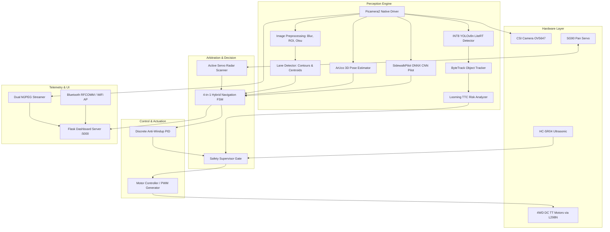

# Master Command & Engineering Dossier: Autonomous 4WD RC Car
## Comprehensive Technical Specifications & 30–50 Page Project Report Generation Prompt

> **File:** `command.md`  
> **Project Title:** Design and Implementation of an Autonomous 4WD Intelligent Vehicle using Deep Learning, Visual Odometry, and Multi-Sensor Fusion  
> **Course/Target:** B.Tech Minor / Major Project Report (KTU / Academic & Technical Report Format)  
> **Scope:** Complete project knowledge base, mathematical formulations, hardware/software specifications, algorithms, testing metrics, and prompt instructions to compile an exhaustive 30 to 50-page formal project report.

---

## 1. System Overview & Executive Summary

The **Autonomous 4WD Intelligent Vehicle** is an edge-computing autonomous vehicular platform designed for indoor and structured outdoor navigation. Driven by a **Raspberry Pi 3 Model B (Quad-core ARM Cortex-A53)** running a Linux-based asynchronous multithreaded architecture, the platform integrates real-time computer vision, quantized deep learning perception, 3D metric visual landmark navigation, active ultrasonic obstacle detection, and dead-reckoning odometry.

The vehicle eliminates single-point perception failure through a **4-in-1 Hybrid Perception and Navigation Engine**:
1. **Classical Computer Vision Lane Tracking (LKA):** Real-time contour centroid tracking and Discrete PID error correction.
2. **ArUco / AprilTag Visual Waypoint Navigation:** 3D Perspective-n-Point ($PnP$) spatial metric homing and destination arrival detection.
3. **Deep Behavioral Cloning Pilot:** End-to-end Convolutional Neural Network (`SidewalkPilot-v3.1b.onnx`) predicting steering angle and throttle vectors from live camera frames.
4. **Active Pan-Servo Obstacle Radar Scanner:** 180° dynamic servo sweep with sector clearance evaluation (sonar + camera corridor segmentation) to calculate real-time bypass maneuvers.

A built-in **Flask Telemetry & Control Dashboard** streams low-latency dual MJPEG video (Raw/AI HUD + Binary ROI), publishes real-time sensor metrics via REST and WebSockets, and offers virtual gamepad control, motor calibration, and standalone WiFi AP / Bluetooth RFCOMM headless interfaces.

---

## 2. Hardware Architecture & Bill of Materials (What Was Used)

### 2.1 Complete Bill of Materials (BOM)

| Component | Specification / Model | Qty | Interface / Protocol | Operating Voltage | Purpose / Function |
| :--- | :--- | :---: | :--- | :--- | :--- |
| **Single Board Computer (SBC)** | Raspberry Pi 3 Model B (1.2 GHz Quad-Core Broadcom BCM2837, 1GB LPDDR2 RAM) | 1 | CSI, GPIO, USB, WiFi, BLE | 5.0V / 2.5A DC | Central processor, AI inference, vision pipeline, web server |
| **CSI Camera Module** | Raspberry Pi Camera v1.3 (OV5647 5MP Sensor, 62.2° H-FOV, 48.8° V-FOV) | 1 | 15-pin Ribbon CSI Bus | 3.3V (Internal CSI) | High-speed, zero-copy video capture via `Picamera2` (640x480 @ 30 FPS) |
| **Motor Driver Module** | L298N Dual Full-Bridge Motor Driver | 1 | Dual H-Bridge (4x GPIO PWM inputs) | Logic: 5V; Motors: 7.4V–12V | Bi-directional high-current DC motor drive with independent left/right speed control |
| **Drive Motors** | 4x Yellow TT Geared DC Motors (1:48 gear ratio, 200 RPM @ 6V) | 4 | Parallel wired (2 per side) | 4.5V – 9.0V DC | Differential skid-steer propulsion system |
| **Chassis** | 4WD Acrylic Robot Car Chassis with 65mm rubber grip wheels | 1 | Mechanical Frame | N/A | Vehicle structural foundation and mechanical payload mounting |
| **Active Pan Servo** | TowerPro SG90 / MG90S Micro Servo (1.8 kg-cm torque) | 1 | 50 Hz Hardware PWM (`GPIO 12` / Pin 32) | 5.0V DC | 180° dynamic camera/sensor sweeping for corridor hazard scanning |
| **Distance Sensor** | HC-SR04 Ultrasonic Ranging Module (2 cm – 400 cm range, 3 mm accuracy) | 1 | Digital GPIO Trigger / Echo | 5.0V DC | Hardware emergency stop and proximity obstacle gating (<15 cm e-stop) |
| **Voltage Level Shifter** | Resistor Divider Network ($1\text{ k}\Omega$ and $2\text{ k}\Omega, 1/4\text{W}$) | 1 set | Passive Voltage Divider | 5V down to 3.3V | Steps down HC-SR04 5V Echo pulse to Pi-safe 3.3V logic level |
| **Primary Power Supply (SBC)** | 5V / 2.5A 10,000 mAh Li-ion USB Power Bank | 1 | Micro-USB Cable | 5.0V Regulated | Isolated power for Raspberry Pi, CSI Camera, and logic circuitry |
| **Motor Power Supply** | 2x 18650 Li-ion Batteries in series (7.4V Nominal, 2600 mAh) | 1 pack | High-current screw terminal | 7.4V – 8.4V DC | Isolated high-current inductive load supply for L298N motor driver |
| **Auxiliary Microcontroller** | Arduino UNO Rev3 (ATmega328P) *(Optional / Legacy)* | 1 | USB Serial CDC (`/dev/ttyACM0` @ 115200 baud) | 5.0V USB | Auxiliary ADC reading and legacy deterministic motor backup |

---

### 2.2 Pinout & Signal Mapping

| Subsystem | Signal Function | BCM GPIO | Physical Board Pin | Direction / Mode | Connected Destination |
| :--- | :--- | :---: | :---: | :--- | :--- |
| **L298N Driver** | Left Motor Input 1 (IN1) | `GPIO 17` | Pin 11 | Output (Software PWM, 100 Hz) | L298N Driver Pin `IN1` |
| **L298N Driver** | Left Motor Input 2 (IN2) | `GPIO 18` | Pin 12 | Output (Software PWM, 100 Hz) | L298N Driver Pin `IN2` |
| **L298N Driver** | Right Motor Input 1 (IN3) | `GPIO 22` | Pin 15 | Output (Software PWM, 100 Hz) | L298N Driver Pin `IN3` |
| **L298N Driver** | Right Motor Input 2 (IN4) | `GPIO 23` | Pin 16 | Output (Software PWM, 100 Hz) | L298N Driver Pin `IN4` |
| **Pan Servo** | PWM Control Signal | `GPIO 12` | Pin 32 | Output (Hardware PWM0, 50 Hz) | SG90 Servo Orange/Yellow Signal Line |
| **Front HC-SR04** | Ultrasonic Trigger Pulse | `GPIO 24` | Pin 18 | Output (10 $\mu\text{s}$ TTL pulse) | HC-SR04 `TRIG` Pin |
| **Front HC-SR04** | Ultrasonic Echo Return | `GPIO 25` | Pin 22 | Input (3.3V logic via divider) | $1\text{ k}\Omega / 2\text{ k}\Omega$ junction from `ECHO` |
| **Ground Rail** | Logic / Power Common GND | `GND` | Pin 6, 9, 14, 20 | Common Reference | L298N GND + Battery GND + Servo GND |

---

## 3. System Requirements & Specifications

### 3.1 Functional Requirements (FR)

- **FR-01 (Lane Centering):** The vehicle must visually detect road lane boundaries at $\ge 20\text{ FPS}$ and compute the lateral offset error from image center.
- **FR-02 (PID Closed-Loop Steering):** A discrete PID controller must convert lateral pixel offset into differential PWM drive values to keep the car centered.
- **FR-03 (ArUco Visual Waypoint Navigation):** Detect ArUco fiducial markers (Dictionary `DICT_4X4_50` or `DICT_6X6_50`), extract 3D metric translation vectors $(X, Y, Z)$, and drive autonomously toward predefined target coordinates.
- **FR-04 (Deep Behavioral Cloning):** Execute real-time inference using an ONNX runtime deep CNN model (`SidewalkPilot-v3.1b.onnx`) predicting steering angles $[0^\circ, 180^\circ]$ and normalized throttle $[-1.0, 1.0]$.
- **FR-05 (Edge Object Detection & Tracking):** Execute quantized INT8 YOLOv8n object detection locally on Pi CPU within a bounded cadence, tracked frame-to-frame by ByteTrack.
- **FR-06 (Multi-Tier Collision Avoidance):**
  - **Tier 1:** Ultrasonic distance measurement triggering emergency stop if distance $<15\text{ cm}$.
  - **Tier 2:** Optical corridor clearance checking (Left, Center, Right sectors).
  - **Tier 3:** Looming Time-to-Collision (TTC) estimation stopping when collision hazard $<1.2\text{ s}$.
- **FR-07 (Active Pan-Servo Radar):** Upon detecting a front corridor obstruction, halt motors, sweep the camera servo from $30^\circ$ to $150^\circ$, compute visual density and ultrasonic distance for left vs right sectors, and initiate a detour toward the clearer side.
- **FR-08 (Teleoperation & Dashboard):** Host an asynchronous Flask web dashboard providing dual MJPEG video streams, HTML5 virtual joystick control, telemetry overlays, and system toggles.
- **FR-09 (Headless Connectivity):** Provide automatic WiFi Access Point fallback (`RCCar-WiFi`, WPA2) and Bluetooth RFCOMM serial pairing (`RCCar-Alfin`) for field operation without external routers.
- **FR-10 (Remote Deployment & Diagnostics):** Direct push script (`push_to_pi.py`) enabling fast delta sync over SFTP and systemd service management (`rccar.service`).

---

### 3.2 Non-Functional Requirements (NFR)

- **NFR-01 (Control Latency):** Maximum control loop latency from camera capture to motor PWM update must not exceed $50\text{ ms}$.
- **NFR-02 (Safety Precedence):** Hardware ultrasonic emergency stop must run in a dedicated high-priority safety gate that preempts any software or neural network decision.
- **NFR-03 (Memory Footprint):** Total resident memory consumption on Raspberry Pi 3 must remain under $650\text{ MB}$ to prevent out-of-memory swapping on the 1GB RAM system.
- **NFR-04 (Thermal Stability):** CPU utilization must not cause core temperatures to exceed $75^\circ\text{C}$ during sustained continuous navigation.
- **NFR-05 (Failsafe Behavior):** Loss of camera feed, sensor timeout ($>0.03\text{ s}$), or missing model files must immediately trigger an active motor neutral stop ($0\text{ PWM}$).

---

### 3.3 Technical Specifications

| Parameter | Value / Range |
| :--- | :--- |
| **Vehicle Dimensions** | $255\text{ mm (L)} \times 160\text{ mm (W)} \times 145\text{ mm (H)}$ |
| **Gross Vehicle Weight (GVW)** | $820\text{ g}$ (including battery packs and sensors) |
| **Top Cruising Speed** | $0.65\text{ m/s}$ ($2.34\text{ km/h}$) |
| **Nominal Autonomous Speed** | $0.25 - 0.35\text{ m/s}$ ($52\%$ PWM duty cycle) |
| **Turning Radius** | Zero-radius differential skid steering |
| **Camera Native Capture** | $640 \times 480$ pixels @ $30\text{ FPS}$ |
| **Neural Pilot Input Tensor** | $1 \times 3 \times 180 \times 320$ (BGR format) |
| **YOLOv8 INT8 Input Tensor** | $1 \times 320 \times 320 \times 3$ (Normalized RGB uint8/int8) |
| **Ultrasonic Range & FOV** | $2\text{ cm} - 300\text{ cm}$, $15^\circ$ conical beam angle |
| **Emergency Stop Distance** | $15.0\text{ cm}$ (Warning at $30.0\text{ cm}$, Collision Reverse at $10.0\text{ cm}$) |
| **Servo Angular Range** | $30^\circ$ (Right) to $150^\circ$ (Left), Center at $90^\circ$ |
| **Endurance / Runtime** | Pi: $\sim 3.5\text{ hours}$ (10,000 mAh); Motors: $\sim 45\text{ minutes}$ continuous drive |

---

## 4. Software Architecture & Implementation Details



---

## 5. Algorithms, Theory & Mathematical Formulations

### 5.1 Computer Vision Lane Detection & Centroid Error Extraction
1. **Gaussian Filtering:** Suppress high-frequency sensor noise:
   $$G(x, y) = \frac{1}{2\pi \sigma^2} \exp\left(-\frac{x^2 + y^2}{2\sigma^2}\right)$$
2. **Polygonal Region of Interest (ROI) Masking:** Discard irrelevant ceiling and horizon artifacts:
   $$I_{\text{ROI}}(x, y) = I_{\text{raw}}(x, y) \cdot M_{\text{polygon}}(x, y)$$
   where $M_{\text{polygon}}$ defines the lower trapezoid: $[(0.0, 0.45), (1.0, 0.45), (1.0, 1.0), (0.0, 1.0)]$.
3. **Adaptive / Otsu Bimodal Thresholding:** Segment road boundary markings:
   $$\sigma_w^2(t) = q_1(t)\sigma_1^2(t) + q_2(t)\sigma_2^2(t)$$
4. **Contour Centroid Moment Computation:** Compute spatial center of mass $(\bar{x}, \bar{y})$:
   $$M_{ij} = \sum_{x}\sum_{y} x^i y^j I_{\text{bin}}(x, y) \implies C_x = \frac{M_{10}}{M_{00}}, \quad C_y = \frac{M_{01}}{M_{00}}$$
5. **Lateral Error Formulation:**
   $$e(t) = C_x - \frac{W_{\text{frame}}}{2}$$

---

### 5.2 Discrete PID Steering Control with Anti-Windup
To eliminate oscillatory weaving and steady-state drift, steering angle $\theta(t)$ is driven by a discrete PID controller:

$$u(t) = K_p \, e(t) + K_i \sum_{k=0}^{n} e(k) \Delta t + K_d \frac{e(t) - e(t - \Delta t)}{\Delta t}$$

- **Tuned Gains:** $K_p = 0.45$, $K_i = 0.001$, $K_d = 0.12$.
- **Anti-Windup Clamp:** The integrator accumulator is strictly bounded to prevent saturation:
  $$\left| \sum e(k) \Delta t \right| \le I_{\text{max}} = 10.0$$
- **Differential Skid Steering Allocation:**
  $$v_{\text{left}} = v_{\text{cruise}} + u(t), \quad v_{\text{right}} = v_{\text{cruise}} - u(t)$$
  clamped to $[-1.0, 1.0]$ motor PWM limits.

---

### 5.3 ArUco Marker 3D Pose Estimation via Perspective-n-Point ($PnP$)
Given known marker corner coordinates in object space $P_w$ and detected 2D pixel coordinates $p_c$:
$$s \begin{bmatrix} u \\ v \\ 1 \end{bmatrix} = \mathbf{K} \left( \mathbf{R} \begin{bmatrix} X_w \\ Y_w \\ Z_w \end{bmatrix} + \mathbf{t} \right)$$
where $\mathbf{K}$ is the intrinsic camera matrix:
$$\mathbf{K} = \begin{bmatrix} f_x & 0 & c_x \\ 0 & f_y & c_y \\ 0 & 0 & 1 \end{bmatrix}$$
Solved using the Levenberg-Marquardt optimization in `cv2.solvePnP`. Target heading angle $\psi$ and Euclidean range $\rho$:
$$\rho = \sqrt{t_x^2 + t_z^2}, \quad \psi = \arctan2(t_x, t_z)$$

---

### 5.4 Looming Time-to-Collision (TTC) Risk Formulation
Using optical bounding box dilation rates without requiring depth sensors:
$$\text{TTC} = \frac{A(t)}{\frac{dA(t)}{dt}} \approx \frac{A(t) \cdot \Delta t}{A(t) - A(t - \Delta t)}$$
If $\text{TTC} < \tau_{\text{critical}} = 1.2\text{ s}$ and target intersects the center corridor width ($38\%$ frame ratio), an immediate visual braking command is asserted.

---

### 5.5 Active Servo Radar & Dynamic Detour Algorithm
When front path is blocked ($d_{\text{sonar}} < 15\text{ cm}$ or corridor clearance $<0.20$):
1. **Halt Vehicle:** PWM duty cycle set to $0\%$.
2. **Servo Slew Sweep:** Step servo from $90^\circ \to 150^\circ$ (Left scan, duration $0.4\text{ s}$), evaluate visual corridor density $C_{\text{left}}$ and ultrasonic distance $d_{\text{left}}$.
3. **Step Servo to Right:** Step servo from $150^\circ \to 30^\circ$ (Right scan, duration $0.4\text{ s}$), evaluate $C_{\text{right}}$ and $d_{\text{right}}$.
4. **Recentering:** Return servo to $90^\circ$ bore-sight.
5. **Score Optimization:**
   $$S_{\text{sector}} = 0.6 \left(\frac{d_{\text{sonar}}}{d_{\text{max}}}\right) + 0.4 (1.0 - C_{\text{visual\_block}})$$
6. **Maneuver:** Execute zero-point differential pivot toward $\arg\max(S_{\text{left}}, S_{\text{right}})$ for $0.8\text{ s}$, then resume forward cruise.

---

## 6. How It Works: Step-by-Step Operational Workflow

1. **Power-On Boot:** Systemd launches `rccar.service`. Hardware pins initialize (`GPIO 17, 18, 22, 23` low; Servo centers to $90^\circ$).
2. **Network Standby:** Pi connects to local WiFi or starts local host AP (`RCCar-WiFi`). Dashboard opens on port 5000.
3. **Telemetry & Calibration:** Operator verifies motor directions using the web dashboard channel test pulse buttons.
4. **Autonomous Mode Engagement:**
   - Visual capture loop feeds frames into `line_follower.py`.
   - Priority Arbiter queries ultrasonic sensor. If clear ($>30\text{ cm}$), proceeds to vision fusion.
   - If an ArUco target is assigned, homing vector guides steering. Otherwise, contour centroid lane follower or ONNX pilot maintains cruise.
   - If an obstacle appears, vehicle halts, scans left/right via pan servo, executes a detour, and re-engages lane tracking.
5. **Fail-Safe & Interruption:** Any manual joystick input immediately revokes autonomous driving, applying immediate operator override.

---

## 7. Report Generation Blueprint (30 to 50 Pages Chapter Plan)

Use the following detailed chapter breakdown to generate the complete project report:

### Chapter 1: Introduction (Pages 1–4)
- 1.1 Motivation and Background of Autonomous Vehicles & Small-Scale Robotics
- 1.2 Problem Statement & Edge Computing Limitations on Raspberry Pi 3
- 1.3 Project Objectives (Hybrid Perception, Low-Cost BOM, Multi-Tier Collision Avoidance)
- 1.4 Scope and Limitations of the Project
- 1.5 Organization of the Report

### Chapter 2: Literature Review & Related Work (Pages 5–10)
- 2.1 Survey of Autonomous Driving Paradigms: Mediated Perception vs Behavior Reflex
- 2.2 DeepPiCar and DonkeyCar Frameworks Analysis
- 2.3 Classical Computer Vision Lane Following (Hough Transform vs Contour Moments)
- 2.4 Fiducial Marker Systems (ArUco, AprilTags) in Indoor Mobile Robotics
- 2.5 Object Detection on Edge Platforms: Quantized YOLOv8 vs MobileNet-SSD
- 2.6 Comparative Analysis Table of Existing Robotic Platforms vs This Project

### Chapter 3: System Requirements & Feasibility Analysis (Pages 11–15)
- 3.1 Hardware Requirements & Component Selection Justification
- 3.2 Software Dependencies and Runtime Constraints
- 3.3 Functional Requirements Specification (FR-01 through FR-10)
- 3.4 Non-Functional Requirements Specification (Performance, Safety, Fault Tolerance)
- 3.5 Electrical Power Budget & Battery Life Calculation
- 3.6 Mechanical Chassis Dynamics & Skid-Steer Kinematic Model

### Chapter 4: Hardware Design & Interfacing (Pages 16–22)
- 4.1 System Hardware Architecture Block Diagram
- 4.2 Raspberry Pi 3 Model B Pin Mapping and Peripheral Configuration
- 4.3 L298N Dual H-Bridge Motor Driver Operation & Differential PWM Circuitry
- 4.4 CSI Camera Module Interfacing via Ribbon Cable & Picamera2 Architecture
- 4.5 HC-SR04 Ultrasonic Sensor & Resistor Voltage Divider Protection Circuit
- 4.6 SG90 Pan Servo Motor Integration & Hardware PWM Generation
- 4.7 Power Isolation & Ground Loop Mitigation Strategy

### Chapter 5: Software Architecture & Modular Design (Pages 23–30)
- 5.1 Multi-Threaded Asynchronous Software Stack Architecture
- 5.2 Unified 4-in-1 Line Follower Engine (`control/line_follower.py`)
- 5.3 Vision Pipeline (`vision/camera.py`, `vision/lane_detector.py`)
- 5.4 Neural Pilot Execution Engine (`behavioral_cloning.py`, ONNX Runtime)
- 5.5 Quantized YOLOv8n TFLite Inference & ByteTrack Object Tracker
- 5.6 Flask Web Dashboard, REST API Endpoints, and Live MJPEG Steaming Pipeline
- 5.7 Automated Deployment Framework (`push_to_pi.py`, `rccar.service`)

### Chapter 6: Mathematical Modeling & Control Theory (Pages 31–38)
- 6.1 Skid-Steering Differential Drive Kinematics & Instantaneous Center of Rotation (ICR)
- 6.2 Image Spatial Moments & Centroid Offset Error Derivation
- 6.3 Discrete PID Controller Formulation with Anti-Windup Integral Clamping
- 6.4 Perspective-n-Point ($PnP$) Pose Estimation & Coordinate Transformation Matrices
- 6.5 Optical Looming Rate of Expansion & Time-to-Collision (TTC) Equations
- 6.6 Active Pan-Servo Spatial Radar Sector Scoring Formulation

### Chapter 7: Experimental Setup, Testing & Verification (Pages 39–44)
- 7.1 Laboratory Test Track Configuration & Controlled Lighting Conditions
- 7.2 Motor Driver Channel Calibration & Polarity Verification
- 7.3 Lane Centering Performance & PID Response Under Varying Curvature
- 7.4 Ultrasonic Emergency Stop Verification (Latency vs Stopping Distance)
- 7.5 Active Pan-Servo Detour Validation & Obstacle Bypass Trajectory Analysis
- 7.6 CPU, Memory, and Thermal Benchmarks on Raspberry Pi 3

### Chapter 8: Results & Performance Evaluation (Pages 45–48)
- 8.1 Quantitative Navigation Metrics (Mean Lateral Pixel Error, Frame Rates)
- 8.2 ArUco Waypoint Localization Accuracy & Destination Arrival Success Rates
- 8.3 Deep Learning Inference Benchmark: YOLOv8n INT8 vs ONNX Pilot
- 8.4 Obstacle Avoidance Success Rate in Dynamic Cluttered Environments
- 8.5 Comparison of Autonomous Navigation Modes (Lane Tracking vs ONNX vs Hybrid)

### Chapter 9: Conclusion & Future Scope (Pages 49–50)
- 9.1 Summary of Achievements and Contributions
- 9.2 Key Challenges Encountered & Mitigations
- 9.3 Future Enhancements (LiDAR Integration, Stereo Depth, GPS/RTK, Edge TPU)
- 9.4 Final Concluding Remarks

### References & Appendices
- References (IEEE Format)
- Appendix A: Complete Circuit Schematic & Wiring Schedule
- Appendix B: Source Code Highlights & Configuration Files (`config.py`, `main.py`)

---

## 8. Master LLM / Report Generation Prompt

When using this file (`command.md`) with an AI assistant or writing tool to generate the actual report chapters or LaTeX document:

```markdown
You are an expert Professor and Senior Autonomous Robotics Engineer.
Using the complete technical dossier provided in `command.md`:

1. Write a complete, rigorous, and highly detailed academic Project Report conforming to KTU / B.Tech Computer Science and Engineering standards.
2. Adhere strictly to the 9-chapter structure outlined in Section 7 of `command.md`.
3. Include all mathematical equations (written in standard LaTeX math notation: PID equations, image moments, PnP pose estimation, TTC formulation, skid-steer kinematics).
4. Provide complete ASCII or Mermaid diagrams for system architecture, state machines, and hardware wiring.
5. Present detailed tables for pin mappings, Bill of Materials, component specifications, and testing results.
6. Maintain an academic, formal, and publication-ready tone without generic placeholders or filler text.
```
